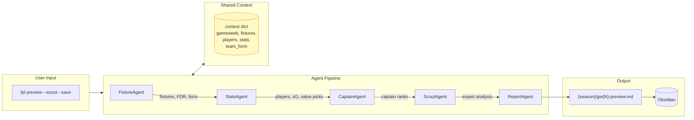
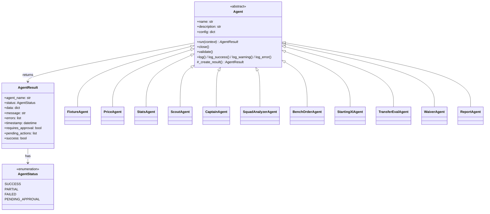
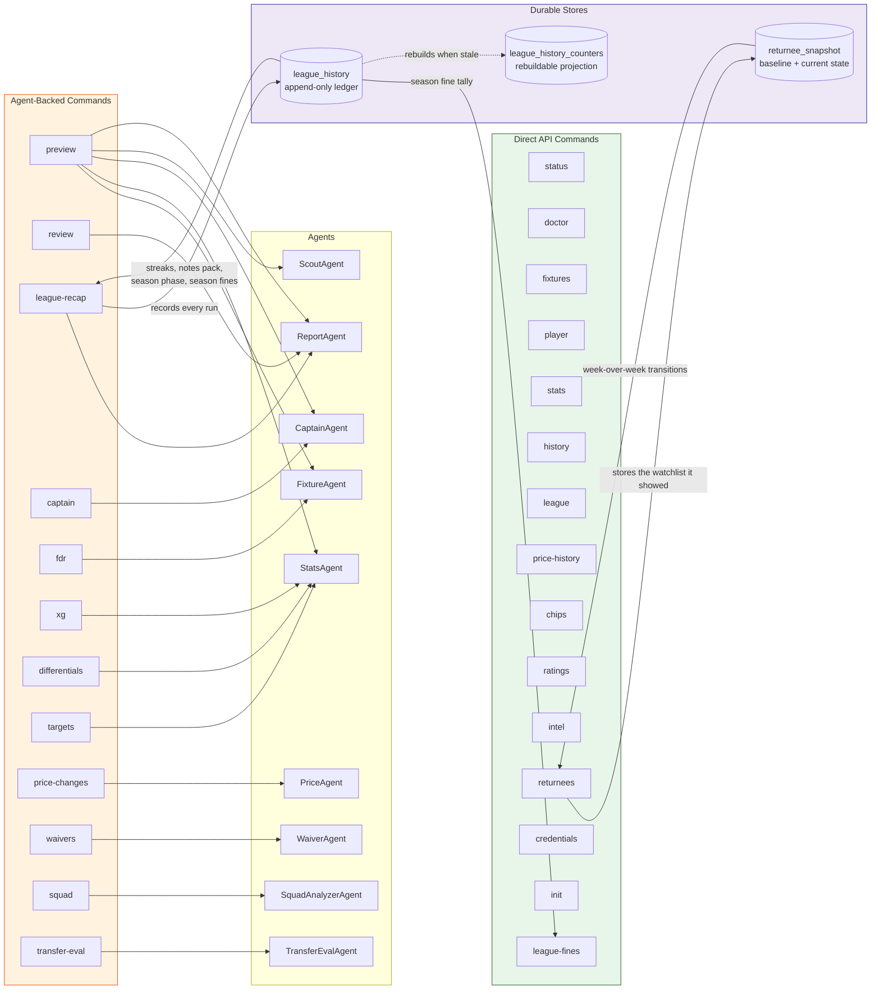
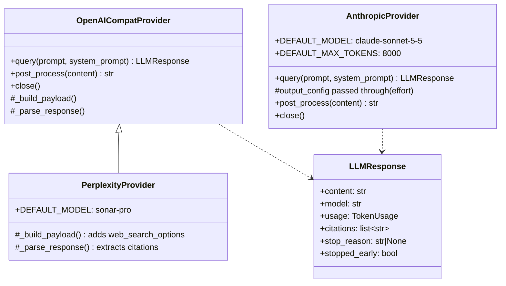
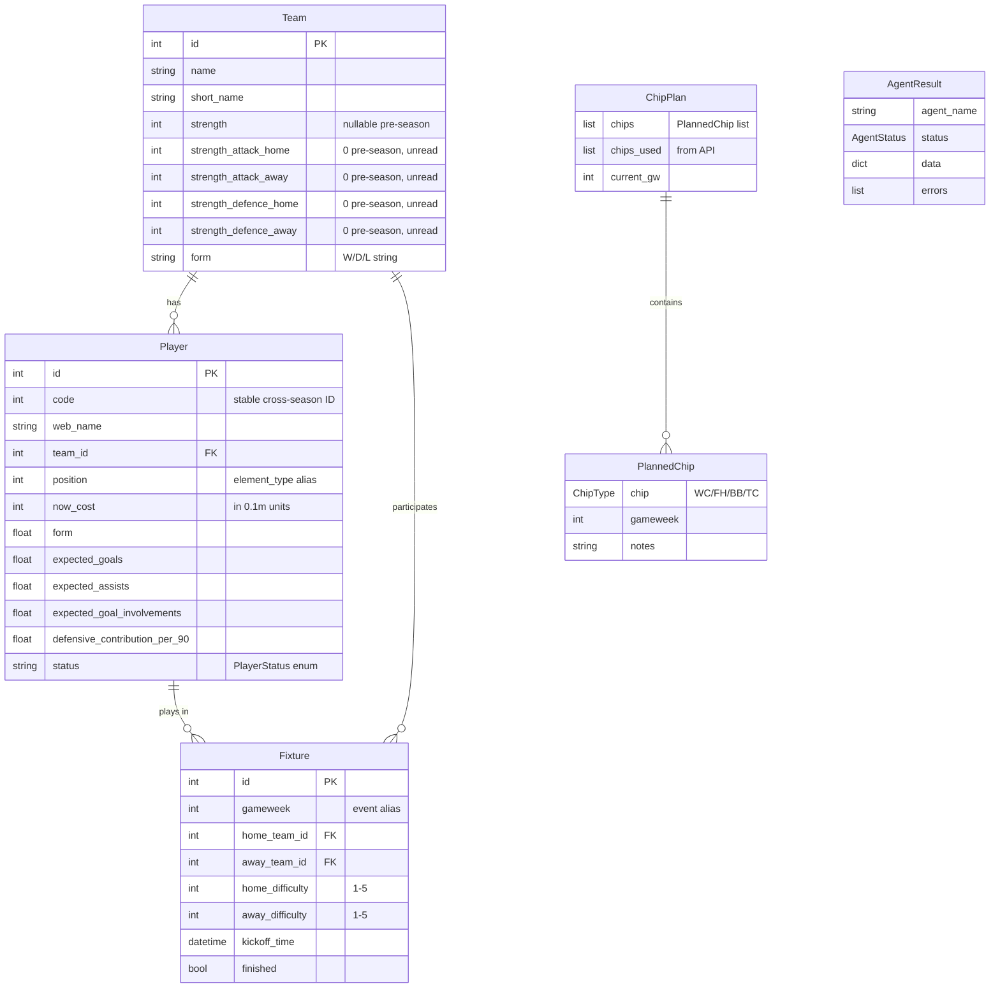
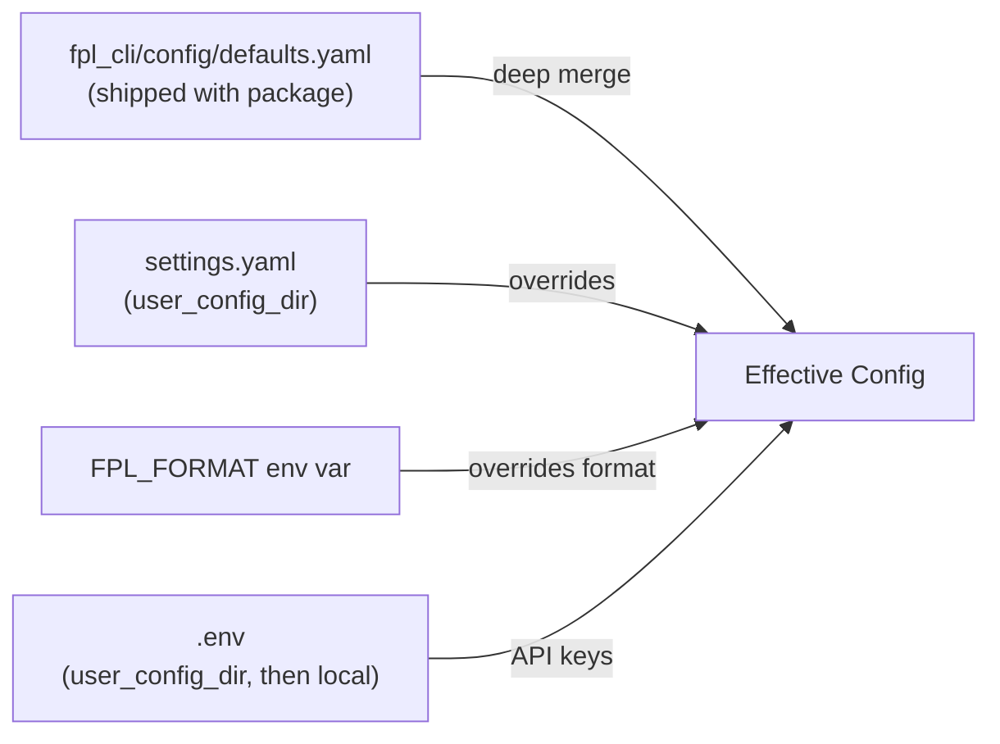

# FPL CLI Architecture

System design and module structure for contributors. For scoring formulas and methodology, see the [Custom Analysis Guide](custom-analysis.md). For command usage, see the [Command Reference](command-reference.md).

```mermaid
flowchart TB
    subgraph CLI["CLI Layer"]
        cli[cli/__init__.py<br/>FormatAwareGroup]
        ctx[_context.py<br/>Format detection]
        helpers[_helpers.py / _json.py<br/>Display & JSON output]
    end

    subgraph Config["Configuration"]
        defaults[config/defaults.yaml]
        settings[~/...fpl-cli/settings.yaml]
        env[".env<br/>API Keys"]
    end

    subgraph Agents["Agent Layer"]
        subgraph DataAgents["Data Agents"]
            fixture[FixtureAgent]
            price[PriceAgent]
            scout[ScoutAgent]
        end

        subgraph AnalysisAgents["Analysis Agents"]
            stats[StatsAgent]
            captain[CaptainAgent]
            squad_analyzer[SquadAnalyzerAgent]
            bench[BenchOrderAgent]
            starting_xi[StartingXIAgent]
            transfer_eval[TransferEvalAgent]
        end

        subgraph ActionAgents["Action Agents"]
            waiver[WaiverAgent]
        end

        subgraph OrchAgents["Orchestration Agents"]
            report[ReportAgent]
        end
    end

    subgraph Services["Services (agent-reachable)"]
        scoring[scoring/<br/>Scoring engine package]
        player_prior[player_prior<br/>Bayesian early-season confidence]
        team_ratings[TeamRatingsService<br/>1-7 strength scale]
        matchup[matchup<br/>3-GW matchup scores]
        fixture_preds[FixturePredictionsService<br/>BGW/DGW predictions]
        team_form[team_form<br/>Form stats]
    end

    subgraph APIClients["API Clients"]
        fpl_client[FPLClient]
        draft_client[FPLDraftClient]
        understat_client[UnderstatClient]
        vaastav_client[VaastavClient]
        core_insights_client[CoreInsightsClient]
        historical_provider[HistoricalDataProvider]
        football_data[FootballDataClient]
        pl_client[PremierLeagueClient]
    end

    subgraph LLMProviders["LLM Providers"]
        anthropic_prov[AnthropicProvider]
        openai_prov[OpenAICompatProvider]
        perplexity_prov[PerplexityProvider]
    end

    subgraph Scraper["Scraper"]
        scraper[FPLPriceScraper]
    end

    subgraph Models["Data Models"]
        player_m[Player]
        fixture_m[Fixture]
        team_m[Team]
        chip_plan[ChipPlan]
        result_m[AgentResult]
        types_m[TypedDicts<br/>CaptainCandidate, WaiverTarget,<br/>EnrichedPlayer, etc.]
    end

    subgraph Prompts["Prompts"]
        scout_p[scout.py]
        review_p[review.py]
        recap_p[league_recap.py]
    end

    subgraph Templates["Jinja2 Templates"]
        preview_tmpl[gw_preview.md.j2]
        review_tmpl[gw_review.md.j2]
        recap_tmpl[gw_league_recap.md.j2]
    end

    subgraph External["External Services"]
        fpl_api[("FPL API")]
        draft_api[("Draft API")]
        understat_web[("understat.com")]
        vaastav_gh[("vaastav/FPL<br/>GitHub")]
        core_insights_gh[("Core-Insights/FPL<br/>GitHub")]
        football_api[("football-data.org")]
        pl_api[("Premier League<br/>data API")]
        llm_apis[("Claude / OpenAI /<br/>Perplexity APIs")]
        fpl_web[("FPL Website")]
    end

    subgraph Output["Output"]
        console[Rich Console]
        obsidian[("Obsidian Vault<br/>01_Reports/{season}/")]
    end

    %% CLI connections
    cli --> ctx
    cli --> helpers
    cli --> defaults & settings & env
    cli --> DataAgents & AnalysisAgents & ActionAgents & OrchAgents

    %% Agent -> Service connections
    fixture --> team_ratings & fixture_preds & matchup
    captain --> scoring
    bench --> scoring
    starting_xi --> scoring
    transfer_eval --> scoring
    stats --> scoring
    waiver --> scoring
    scout --> Prompts

    %% Agent -> API connections
    fixture --> fpl_client
    price --> fpl_client
    stats --> fpl_client
    scout --> LLMProviders
    captain --> fpl_client
    squad_analyzer -->|"get_player_detail()"| fpl_client
    bench --> fpl_client
    starting_xi --> fpl_client
    transfer_eval --> fpl_client
    waiver --> draft_client & fpl_client

    %% Service -> API connections
    player_prior --> historical_provider
    historical_provider --> vaastav_client
    historical_provider --> core_insights_client
    scoring --> player_prior
    team_ratings --> understat_client
    team_ratings --> football_data

    %% Orchestration
    report --> Templates --> obsidian
    report --> console

    %% LLM Provider connections
    anthropic_prov & openai_prov & perplexity_prov --> llm_apis

    %% API Client -> External
    fpl_client --> fpl_api
    draft_client --> draft_api
    understat_client --> understat_web
    vaastav_client --> vaastav_gh
    core_insights_client --> core_insights_gh
    football_data --> football_api
    pl_client --> pl_api
    scraper --> fpl_web

    %% Models
    Agents -.-> Models
    Services -.-> Models

    %% Styling
    classDef cli fill:#e1f5fe,stroke:#01579b
    classDef data fill:#e8f5e9,stroke:#1b5e20
    classDef analysis fill:#fff3e0,stroke:#e65100
    classDef action fill:#ffebee,stroke:#b71c1c
    classDef orch fill:#e3f2fd,stroke:#0d47a1
    classDef service fill:#f1f8e9,stroke:#33691e
    classDef api fill:#fce4ec,stroke:#880e4f
    classDef external fill:#f5f5f5,stroke:#424242
    classDef output fill:#e8eaf6,stroke:#1a237e

    class cli,ctx,helpers cli
    class fixture,price,scout data
    class stats,captain,squad_analyzer,bench,starting_xi,transfer_eval analysis
    class waiver action
    class report orch
    class scoring,team_ratings,matchup,fixture_preds,team_form service
    class fpl_client,draft_client,understat_client,vaastav_client,core_insights_client,historical_provider,football_data,pl_client,scraper,anthropic_prov,openai_prov,perplexity_prov api
    class fpl_api,draft_api,understat_web,vaastav_gh,core_insights_gh,football_api,pl_api,llm_apis,fpl_web external
    class console,obsidian output
```



## Data Flow: Preview Pipeline



## Agent Inheritance



## CLI Command Mapping



### Format Awareness

Commands are classified by format applicability:

| Category | Commands |
|---|---|
| **Classic only** | `captain`, `targets`, `differentials`, `chips`, `credentials` |
| **Draft only** | `waivers` |
| **General** | Everything else (format-gated sections within) |

`FormatAwareGroup` auto-hides inapplicable commands in `--help` based on configured format. Format resolved from settings (`classic_entry_id` / `draft_league_id`) or `FPL_FORMAT` env var.

### Custom Analysis Gating

Commands are independently classified by the `custom_analysis` toggle:

| Category | Commands | When opted out |
|---|---|---|
| **Pure-experimental** | `captain`, `targets`, `differentials`, `waivers`, `allocate`, `transfer-eval`, `ratings` | Unregistered from CLI |
| **Mixed** | `stats`, `xg`, `fdr`, `fixtures`, `player`, `preview` | Experimental columns/sections stripped |
| **Data-only** | Everything else | No change |

`FormatAwareGroup.list_commands()` and `get_command()` filter out the `EXPERIMENTAL` frozenset when `custom_analysis` is off. Mixed commands ask the same question through `_context.py`: `custom_analysis_enabled(ctx)` when the toggle is all they need from the settings (`fdr`, `fixtures`, `xg`), or `is_custom_analysis_enabled(settings)` on the dict `get_settings(ctx)` already gave them when they read other keys too (`stats` needs `rolling_window`, `player` and `preview` the configured entry IDs). Resolving settings at the call site instead is banned by a lint rule — see [Config Resolution](#config-resolution). Both filters (format and experimental) are independent and must both pass.

## Services Layer

Services live in `fpl_cli/services/` and provide the computation layer between agents and API clients. For scoring formulas, weight definitions, and methodology detail, see the [Custom Analysis Guide](custom-analysis.md#services-overview).

| Service | Purpose |
|---|---|
| `scoring/` | Central scoring engine, a package with the public API re-exported from its root (agents import `fpl_cli.services.scoring`). `constants` holds every weight set, ceiling, and consistency magnitude — the ownership/value normalisation ceilings are empirically calibrated per (family, position) by `scripts/calibrate_quality_ceilings.py` (a generated `QUALITY_CEILINGS` block plus a fingerprint of every scoring input and the season the anchors were measured against; a drift-guard test fails when weights change without recalibration, and `calibration_seasons_behind()` gives `fpl doctor` the data-side half a fingerprint cannot cover — #128; `ceiling_attainability()` returns the share of a ceiling's budgeted headroom an input can actually reach, from the weight caps of the terms it can supply; `gk_ceiling_attainability()` is its calendar-keyed special case, scaling the GK anchors' ramped-signal share by the calendar-possible share of the enrichment's 450-minute sample ramp — identity from GW6, uniform across keepers at a gameweek, and only on paths whose numerators carry the GK signals — issue #143; the returnee radar is the other caller, for terms a historical season's source never recorded — issue #132); `data_prep` holds `prepare_scoring_data()`; `coverage` measures how much of the pool each signal the bundle built actually reached (Understat npxG, adjusted npxG, consistency, the history-sourced prior, per-gameweek history, rated fixtures) and turns a share under the signal's floor into the `metadata.warnings` entry every scoring command carries — the tripwires before it fired only on total loss, so a half-failed feed degraded every score silently (#438); `evaluation` builds enrichment and `PlayerEvaluation`/`PlayerIdentity`, holds `read_chance_of_playing()` — the one reader of next-round availability under either spelling (the draft parser's `chance_of_playing`, the model's `chance_of_playing_next_round`), so a caller holding one shape never reads the other as "no news" (#436) — and owns the GK signal block (`gk_signal_enrichment()` derives saves/90, xGC quality and CS rate from season aggregates; `apply_gk_signals()` is the shared merge every keeper-scoring path calls — same shape as `apply_adjusted_npxg()`/`apply_consistency()`, but it lives here rather than in `signals` because `evaluation` already imports `signals`, and it returns whether the block landed so a caller knows if the calibrated GK anchor may be calendar-scaled — issue #207); the scoring families split into `value_quality` (quality baseline + `compute_quality_value()` + the GW1-9 prior blend `blend_quality_with_prior()`, which replaces position-mean shrinkage for the value *and* ownership families — the observed raw score blended with `prior_strength × anchor × CALIBRATION_ELITE_TARGET` weighted by the stored confidence for every position (a keeper-specific `gk_calendar_ramp()` discount was evaluated and dropped in review: the discounted share can only move onto the prior, unevenly across positions on the allocator's summed objective), with the same known-unavailable hold-out; backtested by `scripts/backtest_early_season_prior_blend.py --family ...` through the production function, against pure observation for the value family and against `shrink_scores` for the ownership ones — issues #143 and #206), `ownership` (target/differential/waiver; it runs the blend on its *quality baseline* only, before the matchup, ownership, position-need and consistency bonuses, so `_ownership_anchor_for()` supplies the ceiling without that headroom — a prior models a player's pedigree, not the fixtures in front of them, and the anchor has to be the scale an elite baseline reaches), and `single_gw` (captain/bench/lineup/XI, the one family still shrinking); `display` owns 0-100 normalisation and `pick_display_ceiling()`; `shrinkage` owns `shrink_scores()` (the single-GW family) plus the hold-out helpers (`is_known_unavailable()` / `unavailable_player_ids()`) that keep players known not to be playing out of the position means, out of the adjustment, and out of the blend. `signals` holds the form modifiers — `compute_form_trajectory()` (direction over recent GWs) and `compute_xgi_sustainability()` (ATK-only rolling xGI divergence -> [0.85, 1.15] multiplier) — plus fixture-adjusted npxG (`compute_adjusted_npxg()` / `build_adjusted_npxg_lookup()` normalise historical xG by opponent Elo; `apply_adjusted_npxg()` overwrites `npxG_per_90` in agent enrichment when data is available) and consistency signals (`build_consistency_lookup()` computes 5 per-player signals — CV-xGI percentile, blank rate, floor percentile, involvement rate, GK consistency — with GW6-10 phase-in; additive bonuses per scoring family: target/waiver cv*1.5, differential inverted cv*0.75, lineup cv*0.75, bench floor*1.5+inv*0.75) |
| `player_prior` | Bayesian early-season confidence (GW1-10): the value family blends it into `quality_score` and the ownership family into the quality baseline of its target/differential/waiver scores, while the single-GW family shrinks toward position means with it. `load_or_generate_player_priors()` is the single entry point (cache, else generate and cache, else `None` for graceful degradation; a set last season's history reached too little of is returned uncached and memoised per process, and `informed_priors()` gates it to `None` for every scoring consumer, so `fpl returnees` keeps the price-sourced set for its quality bar while the scores never blend with it — #438), shared by `prepare_scoring_data` and the `fpl stats --value` / `fpl player` commands, which need it because the blend lives inside `compute_quality_value`; `early_season_quality_warning()` is the one notice every prior-blended surface carries in `metadata.warnings` — the value family (`fpl stats --value`, `fpl player`, `fpl allocate`), the ownership family (`fpl targets`, `fpl differentials`, `fpl waivers`) and `fpl transfer-eval`, which shows one score from each — keyed on whether the priors loaded so a blended score is distinguishable from a degraded pure-observation one, and taking `score_names` so it points at the fields the caller actually shows rather than at `quality_score` on a page without one (its single-GW siblings are never named: they still shrink). The via-agent commands decide it in the agent, because only the agent knows whether the priors loaded, and the command routes it to `metadata.warnings` in JSON or stderr in table mode; threads `PlayerProfile.reliability` (historical availability rate) through `PlayerPrior` to agents |
| `team_ratings` | TeamRatingsService + Calculator (1-7 scale, 4 axes). `seed_from_prior()` rebuilds from the previous-season prior instead of serving last season's table whenever the current season cannot rate teams: pre-season, and again in the gap after GW1 kicks off, where the pre-season branch has closed but `calculate_from_fixtures()` still returns nothing (it needs a home *and* an away result per club) — without the second case every fixture fell through to a neutral 4.0. Season-aware: a file stamped (or dated) to a previous season is ignored rather than served, taking its `based_on_gws` with it so a new season recalculates. `check_team_set()` diffs the rated clubs against `bootstrap-static` and names the promoted clubs missing and the relegated ones still rated — the check that catches a rollover a date cannot. `has_ratings` / `is_uniform` / `is_preseason_estimate` flag rating sets that cannot produce meaningful fixture difficulty; every warning surfaces via `get_staleness_warning()`. `get_positional_fdr()`, `get_positional_fdr_pair()` (each column rounded to 1dp — the one rounding boundary) and `get_fixture_fdr()` (that pair's mean) are the only definitions of a fixture's difficulty — the agent and the direct-api `fpl fixtures` both call them, so a match cannot carry two numbers (#202) and the general figure is always the mean of the columns printed beside it; all three FDR surfaces follow the `custom_analysis` toggle to the FPL API's 1-5 difficulty together |
| `matchup` | Fixture matchup scoring (0-10), 3-GW recency-weighted |
| `fixture_predictions` | BGW/DGW predictions from YAML + live detection. `find_blank_gameweeks()` answers "did this club play" from the club a player is at *now*, which is all the bootstrap knows; `resolve_players_with_fixture()` answers it from the gameweek itself, reading the live payload's per-club-fixture `explain` entries, and `had_fixture()` prefers that answer and falls back to the club when the gameweek cannot give one (unstarted, part-played, or a payload whose `explain`s have not populated). `find_double_gameweeks()` / `resolve_players_with_double()` / `is_double_gameweek()` are the same three off the same signal, counting the `explain` entries rather than testing for one. `is_blank_gameweek()` is `had_fixture()` inverted, for callers populating a `bgw` field. Anything reading a past gameweek needs the point-in-time answers: a player transferred since carries his current club's fixtures, not the ones he actually had (issues #169, #174) |
| `player_clubs` | Which club a player was on the books at in a gameweek already played. The bootstrap only knows where he is *now*, so a replay stamps today's club onto a past gameweek's squad (issue #169); the identity carry covers that wherever a detailed row was already recorded, but a first capture and a coarse-to-detailed upgrade (which stores no squad) have nothing to carry, and the second is the documented `--backfill-detail` workflow (issue #177). `resolve_player_fixtures()` reads the same live-payload `explain` signal `fixture_predictions` does, keeping *which* fixtures rather than only whether there were any; `narrow_clubs()` intersects each fixture's two clubs, so a double settles a club outright and a single leaves two; `settle_clubs()` settles only what is exact — a single-club intersection — and treats today's club being outside the pair as proof he moved, which is the one case worth an `element-summary/{id}/` request (its `was_home` plus the fixture's clubs is exact). Today's club being *inside* the pair is deliberately no answer at all: it reads as "he has not moved" but a player who moved between those two clubs is indistinguishable, and the wrong answer would equal today's club and so be unflaggable, so it must not outrank a recorded club. That gives a three-step ladder — an exact derivation, then the recorded club, then today's — which `derived_player_codes()` hands to the identity carry. `GameweekClubResolver` orchestrates it, returns the `had_fixture` set off the same scan, and caches the fetch per player across the whole run (only a 4xx is cached; a timeout or 5xx is retried, since one resolver serves a whole backfill). Club only: name and position are not derivable from fixtures and stay carry-forward-only |
| `season_previews` | Hand-curated per-team season intel from `<config dir>/previews/*.yaml`. Per-section decay (`SECTION_DECAY`) ages each kind of claim out at the gameweek something better supersedes it — injuries at GW2, projected XIs at GW7, team strength at GW13 to mirror `team_ratings_prior.BLENDING_CUTOFF_GW`. `coverage()` centralises the usage gate (`full` / `negative_filter_only` / `none`) so the three consuming skills cannot drift apart on the threshold. Deterministic name resolution (`resolve_name`) matches preview prose to `element_code`, reporting ambiguity rather than guessing; `write_resolved_codes` saves via round-trip YAML so hand-written comments survive |
| `squad_allocator` | ILP squad allocator (PuLP CBC), horizon-aware, chip-aware |
| `returnee_radar` | Injury returnee radar behind `fpl returnees`. Parses the FPL `news` grammar into a `ReturnSignal` (four shapes, only two of them dated), filters on a window and a **source-aware** quality bar, and diffs the result against a persisted snapshot for week-over-week transitions. The bar is source-aware because `player_prior` only assigns `source="history"` at 450+ minutes in the previous season and caps `prior_strength` at 0.5 on the `"price"` fallback, so one flat threshold would exclude exactly the players who missed most of last season through injury: history-sourced players are gated on `prior_strength`, price-sourced ones are scored through `value_quality` over their most recent season carrying real minutes, and the within-position price percentile is the last resort. That season supplies the DEF/GK weight terms (defensive contribution, saves, clean sheets, xGC per 90) from the `SeasonHistory` row when its source published them, and otherwise shrinks the ceiling via `ceiling_attainability()` rather than reading the gap as a measured zero — without which no keeper and effectively no defender could clear the bar (#132). `run_radar()` is the public entry point (snapshot I/O included); `build_radar()` is the pure core. The `SnapshotStore` behind it holds two states — the baseline every run in the current gameweek diffs against, and the current gameweek's own, promoted to baseline when the gameweek moves on — so a second run in one gameweek reports the same transitions as the first instead of diffing against what that run just stored (#225). **Fetches nothing** — the caller injects historical profiles and Understat season data, because `prepare_scoring_data` discards the profiles it built priors from and skips fetching them at all on a cache hit. Optional AI-search enrichment (`--enrich`) attaches an `EnrichedReturn` beside the FPL signal, never over it, and only a *cited* enriched date can decide an escalation |
| `team_form` | Rolling team form stats (last 6 matches, venue splits) |
| `league_history` | Durable league-history ledger: one NDJSON file per gameweek under `<data dir>/league_history/<season>/<format>-<league id>/`, written as a side effect of `league-recap`. Append-only — an identical row writes nothing, a differing one appends a superseding line, and readers resolve by highest fidelity tier then latest capture, with an unknown row ranking below every tier. Each row carries its own schema version: an older one is upgraded in memory on read (the line on disk is never rewritten, so a store shared with an older install stays readable by it), a newer one is skipped with a warning and preserved byte-for-byte — and every line the store writes is stamped with the writing install's version whatever version the row was read at, since a superseding line copied off a version-5 row but carrying a version-6 field would be validated by a version-5 install rather than skipped, and rejected as a corrupt file. Two deliberate inversions of house convention: loading **fails closed** (unlike `chip_plan`, which resets on a corrupt file) because the API cannot rebuild a past gameweek — scoped to that one gameweek, whose coverage entry carries the file path and the `mv` that retires it, so a caller reports it as `league_history_store_unreadable` rather than as a coverage gap `--backfill-detail` would refuse to fill, and reports it once per run however many of a recap's readers hit the same file — and season is a **partition key** (unlike `team_ratings`, which discards a previous season) because per-gameweek granularity is destroyed at the July rollover. The consequence of partitioning is that the store only ever grows — nothing prunes a prior season, by design — at roughly a few megabytes per league per season |
| `league_history_counters` | Declarative streak-condition registry (9 conditions: `weeks_on_top`, `bottom_half_run`, `gw_win_streak`, `gw_loss_streak`, `green_arrow_drought` shared; `captain_blank_run`, `hit_run` classic-only; `waiver_win_run`, `waiver_burn_run` draft-only) and the rebuildable counters projection it drives. Each entry declares the minimum run worth surfacing as a streak, `None` for the two conditions (bottom half, green-arrow drought) whose run only drives their season count's firing rule. Each predicate returns extend/reset/hold/inapplicable for one manager's row, and the last two both leave the run untouched, so neither a capture gap nor an impossibility ever lies about a streak in either direction. They differ in what the record says: hold is a gameweek it cannot rule (an unknown row, a field the tier never captured), inapplicable one it rules completely where the condition had nothing to judge (a draft manager with no completed waiver moves, whether they made no claims or lost every one, a captain with no fixture, a cohort level on points, a green-arrow drought gameweek begun in first place). Each run counts them separately, and each condition that can return inapplicable names it in its own words (`inapplicable_label`), so a complete gameweek is never reported as missing (issue #358). Alongside each currently-open run, the state carries season-wide occurrence totals (issue #164): every extending gameweek counts once and survives a reset, holds (not inapplicable gameweeks, which were judged) are tallied separately as the count's "not judged" qualifier, and the last-occurrence and first-evaluated gameweeks bound what a consumer may claim — so "their sixth gameweek win of the season" is derivable, not just the open run. Each entry also declares a `CountSurfacePolicy`, the condition's own rule for when that total is worth rendering weekly (U9 applies it; the milestone set-pieces and `--format json` ignore it). The projection is a disposable cache (never a second source of truth) under `<data dir>/league_history_counters/<season>/<format>-<league id>/counters.json`: it advances one gameweek at a time when its stamp is exactly one behind, and **fails open** to a full rebuild from `league_history`'s rows otherwise — missing, unreadable, wrong-version, or a stamp that isn't stamp+1 (which is also what makes the season totals retroactive: the version bump that added them rebuilds silently from rows already on disk) |
| `league_history_fines` | Season fine tally (`build_season_fines_tally()`): a pure fold over `league_history`'s rows into per-manager, per-rule counts, with no cache and no second source of truth. Counts only what a row already recorded, so a settings change moves future rulings and leaves history alone — a guarantee `_freeze_recorded_fines` (`cli/_league_recap_history.py`) carries into backfill, where a repair would otherwise re-rule an unchanged cohort under whatever config is current at repair time. Every gameweek that could not be ruled is named as a qualifier rather than folded in as a zero — never captured, unreadable, captured but reaching nobody (every row unknown), holding no record of what was ruled (schema version < 4, or an evaluation that raised), recording a ruling on no rules at all, or captured at a fidelity that could not rule a given rule. Each qualifier states only what the ledger can prove: where two causes are indistinguishable from a row, neither is named. A mid-season joiner keeps their real, lower totals and is qualified; a manager who has since left keeps the fines already ruled against them, bounded to the gameweeks they were recorded for. Rulings are tracked per rule as well as per manager (`unruled_gameweeks_for()`), since a coarse gameweek rules `last-place` and structurally cannot rule `red-card` — the recap prompt asks that question before it will call a fine a manager's first of the season. `last-place` is the one cohort-relative rule, so it is the one a tie falls on: every manager level on the gameweek's lowest score is fined, and `_repair_tied_last_place` sweeps gameweeks recorded before that was true, appending the ruling the gameweek already wrote against the managers it left out rather than re-ruling anything (issue #336) |
| `league_history_months` | Manager and Dud of the Month and the season's honours list (`build_monthly_honours()`, issue #425): a pure fold over `league_history`'s rows into each completed month's ranked totals, with no cache and no second source of truth, like `league_history_fines`, so a re-captured gameweek takes its month's awards with it. A month is a `SeasonMonth` (`models/season_month.py`), read off bootstrap-static's `phases` by `FPLClient.get_months()`, which leaves out the season-long phase by its span rather than its id or name; draft reads the main game's months, its gameweeks being the same. Scored as FPL's own month table scores it: each gameweek's points net of its hit, except the month's first gameweek, whose hit FPL's month tables charge to no month, leaving them short of the season table by that hit (observed on the public Overall league's and three mini-leagues' month tables, see `docs/command-reference.md`), which is neither the weekly awards' measure nor `_net_gw_points`'. A month's table is the managers with a row in its last gameweek; any gap among them (an unknown row, an uncaptured or unreadable gameweek, a missing row) withholds both awards with a reason rather than handing the manager with missing points the Dud, a classic row with no hit recorded is a gap too, a month the league began partway through counts from its first gameweek, as FPL's table for that league does, and one before it is left out, a league the recap read only in part (`partial_league`, classic standings past one page) has every month withheld, and ties share by `competition_rank()` (`utils/ranking.py`), the recap's own ranking. `capture_recap_history` builds it after the backfill, so a gap that run filled is awarded at once, and the recap cross-checks the month a classic recap closes against FPL's own table (`get_classic_league_standings(..., month_id=...)`, `?phase=N`) before either award is placed, a disagreement withholding that month on every surface (`MonthlyHonours.withholding()`) with a warning, never a stop |
| `league_history_notes` | Notes pack (`build_notes_pack()`), season-phase marker (`derive_season_phase()`, standalone) and the `is_season_milestone()` predicate the recap gates its *printed* season fines table and Monthly Honours list on (the fines' prompt section is ungated, and the honours' also reaches the editorial on each month's last gameweek) - the phase's *first* gameweek and the finale, deliberately not the whole 13-gameweek midpoint phase, since a once-a-season set-piece fired thirteen times is wallpaper built from `league_history_counters`'s projection plus a bounded trailing window of raw ledger rows (`TRAILING_WINDOW_GAMEWEEKS = 6`, reused as the run-in phase's own length). Every open streak renders as an observed count over its true span rather than "in a row" once its window is wider than its run (e.g. "3 in the last 11, with 8 not recorded"), and the trailing clause separates the gameweeks the record lacks ("not recorded": unknown, uncaptured or absent) from the ones the condition had nothing to judge in, named by the condition ("with no completed moves in 1"); each entry declares which of console/report/prompt it reaches — a reportable streak reaches all three, coverage statements reach report+prompt, the season-phase marker is prompt-only (scene-setting for the editorial, never printed in the report — issue #187), and a below-minimum streak is retained (exposed via `--format json`) with no surfaces. Streak and season-count entries also carry `prompt_text`, the same fact as a sentence for the editorial prompt ("Alice has 3 captain blanks in the last 6 (GW1-GW6). Of the rest, 2 were not recorded."), which `format_recap_league_history_context()` reads through `text_for(NoteSurface.PROMPT)` while console, report and `--format json` keep the ledger line: the model quotes whatever it is handed, and the ledger row is not a sentence a columnist would write (issue #452). Season-count entries (issue #164) render each condition's season occurrence total over the manager's own evaluated span, with holds stated as "not judged either way", surfaced per the registry's own declarative `CountSurfacePolicy` (a step the total must land on, run-length milestones read off the open run rather than the total, a first-occurrence rule gated on the season's half, a whole-condition second-half gate, and a ride-along rule for same-gameweek peers — an absolute floor for counts that stay small, a window relative to the nearest firing total for counts that climb all season). Evaluation is two-pass because firing is cross-manager: who fired their condition this gameweek, then which same-gameweek incrementers ride along beside them. Every nonzero count is retained for `--format json`, and at the two `is_season_milestone()` gameweeks the whole nonzero set carries report+prompt — the report's `## Season Counts` set-piece and the retrospective editorial's season-spanning facts. A "since GW X" qualifier is stated only when a partition's or a specific manager's own recorded coverage genuinely begins later than the league's start gameweek, never merely because a trailing window was read. Only the finale phase rescans every captured gameweek (via `rebuild_counters_through`, never the cached `compute_counters_through`) so weekly cost stays flat as the season progresses. The one weekly exception is the season-record entries (issue #494): the league's highest and lowest gameweek score this season, each naming every score that reached it with its manager and gameweek ("this gameweek" for the recapped one, plus "No score this gameweek equalled it" where it fell short), swept over every gameweek from the league's start the way `league_history_fines` sweeps them — the store memoizes each read, so the two share it. They are scored as the GW Standings section scores the week (gross, or net of the hit under `use_net_points`, passed in since the row does not record it); only a score the row proves counts (not an unknown row's, nor under `use_net_points` a classic row's that never recorded its hit), and a gameweek with such a row, no row for a manager in the recapped gameweek's league, an unreadable file or no capture is named in the line's qualifier ("not every score was recorded in GW2"). The recap stashes both records on `LeagueRecapData` (`season_highest_score` / `season_lowest_score`) so `check_tie_claims` can read a record scored more than once as a shared one. Prompt-only, and absent on the league's first gameweek, where they would only restate that week's extremes. The personal-record entries (issue #496) read each manager's own highest and lowest gameweek score off the same sweep and the same scoring pass (`_season_scores`, one `_recorded_score` per row for both kinds of record), over the league's span from its start, qualified by the manager's own unrecorded gameweeks ("their scores were not recorded in GW1-4"), the gameweeks before their first row included, since a classic league scores its members from its start whenever they joined and a ledger begun mid-season holds nobody's earlier scores. Every manager in the recapped gameweek with two or more recorded scores gets both entries for `--format json`, a week that set or equalled one worded with the record before it ("above their previous highest of 61 in GW9", or "equalling ... also scored in GW9"). Only a week that set or equalled the record, with at least `PERSONAL_RECORD_MIN_GAMEWEEKS` (10) recorded scores behind it, carries the prompt surface, counted per manager so a mid-season joiner waits for their own scores, at the milestones as on any other week. At the two milestones `personal_record_tables` also ranks every manager with a recorded score, a single one included, in a highs table highest first and a lows table lowest first, competition-ranked (`competition_rank`) so a tie is a shared place; each row carries its record's `gameweeks` and its own `unrecorded` gameweeks as fields (its `detail` only words them), and gameweeks nobody's score was recorded in are the table's `unrecorded`, stated once in its `span`. The tables are views of the same per-manager pass (`_manager_seasons`), not entries, and the recap prints them in the report's Season Highs and Lows subsection and the editorial's League History section; the recap also hands them and the week's equalled personal records to `check_tie_claims`, which reads a shared place or an equalled record as the tie it is. The constant was settled against a real season's ledger, where a threshold of 8 would have shown the editorial about half of each league at GW8; once live, a gate on own gameweeks sets when the line starts, not how often it fires, which stays near two managers in N a week at their Nth gameweek |
| `draft_provenance` | How each owned draft player came to his manager (#458), replayed from the league's own history: the draft in force (the latest completed entry in `league.drafts` at or before the gameweek, its picks from the choices feed or, when the feed has none for that draft id, from the `league_history_drafts` snapshot), then every accepted transaction by `added` and every processed trade (`is_processed_trade()`: `p`, not the vetoed `v`) by `response_time`, in one time order, keeping each player's full chain (`DraftStep`: draft, waiver, free_agent, trade, release). `replay_draft_history()` trusts the replay only when it ends exactly where `element_status` says everyone is now and, stopped at the gameweek, matches the squads the caller observed; any disagreement, a move that does not fit the squad it applies to, or a log that could not be read (`read_draft_logs()` degrades a failed read to a missing log, never an exception; the trades log is one of them, since a trade and its reversal leave no mark on either check) returns no players and a `problem` the recap reports as `draft_provenance_unavailable`. Where neither source has a held draft's picks (a redraft was scheduled before the first snapshot) the start is rebuilt instead: each manager's squad at the draft's gameweek (`read_draft_logs(entry_ids=...)`, one request each, only then), with the moves made before that gameweek undone newest first, so the chains begin at a draft step with no pick (`DraftInForce.rounds_known` False) and run on under the same two checks; because a start derived from the logs cannot reveal a move they lack, a pre-gameweek trade made since the draft in an unseen state, an unreadable squad or an undone move that does not fit all refuse it. No squad is read when another log is missing, since the replay refuses without them. The squads cost those requests once (#472): the replay records the drafts it rebuilt (`DraftProvenance.rebuilt_drafts`) and any whose squads did not fit the moves undone (`misfit_drafts`), `keep_rebuild_squads()` keeps the squads read from the API for each draft a passing replay rebuilt once the draft game's `current_event` has reached its gameweek, and `read_draft_logs()` reads that copy third, after the feed's picks and the snapshot's and before asking the API (`DraftLogs.kept_squads` names the drafts it served); only a misfit drops a copy. `DraftLogs.choices_payload` is the choices response itself, which the recap hands to the picks snapshot so the endpoint is read once. One shared helper (`get_draft_provenance()`) so the recap's Standout Players section and the draft lines of `fpl player` and `fpl stats` (#460) read the draft one way. Beside the owned players' chains, `DraftProvenance.released` keeps the chain of every player the replay held and let go (`DraftFreeAgentHistory`, ending on his release), so a lookup can say a free agent's last exit and whether he was drafted; a player in neither was never held. The lookups reach it through `get_draft_ownership_mapping(with_provenance=True)` (`agents/common.py`), which reads the history alongside the squads, reusing the league details it already fetched, and replays it to the coming gameweek (`next_event`, else `current_event`) with no observed squads: that is the history checked against `element_status`, so its owners are FPL's, and a waiver run processed for the coming gameweek is in it even while the current squads lag. An enrichment failure of any kind becomes a `problem`, never an exception that would cost the ownership read beside it. `cli/_draft_provenance.py` turns a player's history into the line, the `fpl stats` tag and `info.draft` through one pick formatter, describing a player only where the replay's owner is the one the command shows, so a player whose move the squads have not caught up with, or whose squad could not be read, gets the plain line. |
| `draft_rebuild_cache` | The squads a lost draft's picks were rebuilt from (#472), one file per draft at `<cache dir>/draft_rebuilds/draft-<league id>/draft-<draft id>.json`, stamped with the season and the draft's gameweek. Kept only by `draft_provenance.keep_rebuild_squads()`, for a draft a replay rebuilt from squads read from the API and passed on, once the draft game's `current_event` (memoised game state, read only when there is something to keep) has reached the draft's gameweek. What that replay checked depends on the caller: the undone moves always fit the squads, a draft the whole history runs from also ends on `element_status`, and the recap also holds the gameweek to its squads; an older draft in force on the lookup path has the fit alone, as a live read there does. That is enough because a gameweek's squads are locked from its deadline, so the copy is the squads any later read would return. The squads rather than the set rebuilt from them, so a run reading the copy undoes the pre-gameweek moves and applies every check it would apply to a live read. A copy is dropped only when its squads do not fit the moves undone (`DraftProvenance.misfit_drafts`), the one refusal it can be blamed for (one kept before the deadline, say); a refusal on the ownership list after a waiver run leaves it. Cache-class, not ledger-class like the snapshots: the endpoint serves the squads all season. A file that cannot be read, has the wrong shape, is stamped with another season or gameweek, or holds other managers than the league's is no file, and a failed write costs only the next run's reads |
| `league_history_vouchers` | The draft Player of the Month voucher (#492): who held a month's winner for each of its gameweeks (`gameweek_holder()`, joined on `code`, bench included), read off `league_history`'s squads on every run like `league_history_months`, never stored, so a re-captured gameweek corrects it; and the record of each month's announcement, one file per month under the draft ledger partition's `awards/` (`<data dir>/league_history/<season>/draft-<league id>/awards/player-of-the-month-<YYYY>-<MM>.json`), holding the feed's entry as served or the override's code, when fpl-cli first saw it, the gameweek whose recap announced it and whether it withheld the voucher. That gameweek is what announces each month once: re-running that recap shows it again and no other recap does, and the one rewrite is a withheld month's, settled by the first latest-gameweek recap that can say who held him. A gameweek says nobody held him only when every manager in it has a recorded squad of identified players and the recap read the whole league (`partial_league_reason()`, as the monthly honours take it); anything less withholds the voucher at the month's end and qualifies the holding line earlier in the month, though finding him settles it, ownership being exclusive. Orchestrated by `capture_player_of_the_month()` (`cli/_league_recap_vouchers.py`) on the capture's own store (`CaptureResult.store`), which asks the awards feed only from the latest finished gameweek's recap and only for a completed month with neither a record nor an override (May, which has no award, never), announces only from that recap, and treats a winner whose code neither the bootstrap nor the month's squads know as not checked rather than as nobody's |
| `league_history_drafts` | Draft-picks snapshots (`snapshot_draft_choices()`), one file per held draft under the draft ledger partition's `drafts/` (`<data dir>/league_history/<season>/draft-<league id>/drafts/draft-<draft id>.json`), written by `league-recap --draft` through `capture_draft_picks()` (`cli/_league_recap_history.py`) after the gameweek's rows. Ledger-class data rather than a cache: `FPLDraftClient.get_draft_choices()` serves only the league's latest draft, so a scheduled redraft drops the previous draft's picks from the API for good (#461). Each file is the endpoint's response as served plus the draft's `league.drafts` entry under `league_draft`, so a hand-saved response is a valid snapshot too. Written once and never rewritten: a later run compares the picks alone (`PICK_FIELDS`), because the response's `element_status` is today's ownership and moves every waiver round, and a difference leaves the file untouched and is reported (`league_history_draft_picks_conflict`). A held draft no longer served counts as kept only when its file holds at least one of its picks, so an empty capture or an error page cannot stand in for a copy; otherwise the loss is reported once (`league_history_draft_picks_lost`) and recorded in `lost-draft-<draft id>.json` so later runs stay quiet. A response with no `choices` list is a failed read, never "no picks served", and a `league.drafts` entry without a numeric `id` and a `draft_completed` (the API sends a completion timestamp, or `null` before the draft is held; a bool is accepted too) is reported (`league_history_draft_picks_unchecked`) rather than skipped, since quietly skipping it would lose a held draft's picks with no sign. Every outcome is a value rather than an exception, reads included (no `exists()` probe that a permission error could raise through), so a file problem costs the snapshot and never the recap. `LeagueHistoryStore.partition_exists()` asks for gameweek files rather than the directory, so a snapshot landing first cannot swallow the first-capture notice. The `draft_provenance` replay reads them back (`read_saved_choices()`, `is_draft_lost()`) when the feed has moved on, and the recap hands `capture_draft_picks()` the choices response the replay already read so the endpoint is requested once per run; one loader (`_load_snapshot()`) decides what a readable snapshot is for the writer and the readers |

## LLM Provider Abstraction



All providers share the `LLMResponse` contract. `OpenAICompatProvider` supports OpenAI, Groq, Together, Ollama via configurable `base_url`. Provider selection configured in settings. `AnthropicProvider` sends `max_tokens` (falling back to `DEFAULT_MAX_TOKENS`, 8000, when the role's config has none, since thinking shares that ceiling) and passes a role's `query_defaults.output_config` through to the request, which is how the synthesis role pins its effort in `defaults.yaml` rather than inheriting whatever the model defaults to; a key set to null is dropped, `effort` is left off a model that predates it (`_PRE_EFFORT_MODEL_RE`, a closed set, so it cannot go stale the way an allowlist would), and a block that is not a mapping raises `ProviderError`. `OpenAICompatProvider` ignores `output_config`, which is not part of the chat-completions shape.

`stop_reason` carries the provider's own verdict on why generation ended, verbatim in whichever vocabulary it used — Anthropic's `stop_reason`, an OpenAI-compatible API's `finish_reason`. `stopped_early` reads it against `NORMAL_STOP_REASONS`, a single set covering both dialects (the vocabularies do not collide), and every provider announces an abnormal one at WARNING via `log_abnormal_stop` — the same reason `_http` announces its retries there, so a truncation is visible on any command that talks to an LLM. `truncated` reads it against `TRUNCATION_STOP_REASONS`, the token-ceiling subset (`max_tokens`, `length`): the only abnormal stop worth a retry on its own. `refused` reads it against `REFUSAL_STOP_REASONS` (`refusal`, `content_filter`), the stops that rule a retry out, since re-sending a refused request to the same model usually draws another refusal. `cli/_synthesis_retry.py` is the consumer of both; it returns the attempt that ships (whose `number` says whether it was the first answer or the retry), how many answers were judged, and the `TokenUsage` they spent between them. `stop_category` carries a refusal's category when the provider names one (Anthropic's `stop_details.category`; OpenAI-compatible APIs have no equivalent), so `log_abnormal_stop` and the recap's refusal wording can say which check declined the answer rather than only that one did; every other stop leaves it `None`. `None` means the provider said nothing, which is never treated as evidence of truncation. Without this a cut-off response and a complete one were indistinguishable downstream, which is how a saved gameweek review shipped missing a whole format's verdict at exit 0 (#266). `log_textless_response` is its companion for the other half of that failure: a reasoning model that reaches the ceiling mid-thought returns content with no text block in it at all, so the concatenated prose is `""` — honest, but indistinguishable from a model with nothing to say until the non-text blocks that did arrive are named (#306). Unlike `log_abnormal_stop` this one is Anthropic-only, because only the Messages API returns typed content blocks — an OpenAI-compatible reply carries a plain `message.content` string, so there is nothing to name when it comes back empty. What catches an empty answer whatever produced it is `check_synthesis_completeness`'s `empty` flag, one layer along, which reads the string the report would carry rather than the envelope it arrived in.

Both HTTP providers post through `_http.post_json_with_retry`, the one place their error handling lives: it retries an HTTP 429 with `RetryPolicy` (exponential backoff with jitter, `Retry-After` honoured, the whole wait bounded by one budget, each retry announced at WARNING) and raises `RateLimitError` — a `ProviderError` subclass carrying the server's `retry_after` — once the attempts are spent, and turns every other error status, a timeout, or a non-JSON body into a sanitised `ProviderError`. That is the same 429-is-transient distinction `DatasetFetcher` draws for the historical datasets. The module also holds `QueryPacer`, which keeps request starts a configured interval apart for a caller that fires several queries at once; `fpl returnees --enrich` pairs it with an in-flight cap, reads the typed error to re-query only the rate-limited subset of its shortlist once, and reports a still-refused player as rate-limited rather than unanswered.

## API Clients

| Client | External Source | Purpose |
|---|---|---|
| `FPLClient` | FPL API | Players, fixtures, managers, teams, bootstrap-static (cached), the season's months (`get_months()`, off the cached bootstrap) and a classic league's table for one month (`get_classic_league_standings(..., month_id=...)`) |
| `FPLDraftClient` | FPL Draft API | Draft leagues, waivers, squad data |
| `UnderstatClient` | understat.com | npxG, xA, xGChain, xGBuildup per-90 stats; per-team match xG via `get_team()`, which keeps only the season it asked for (`matches_in_season()`) because understat.com answers a season a club has no record of with that club's most recent one — for a promoted club, the season in progress (#235) |
| `VaastavClient` | vaastav/FPL GitHub | Historical CSV data for the two oldest seasons of the four-season window, price trends, GW-level profiles |
| `CoreInsightsClient` | Core-Insights/FPL GitHub | CSV data for last season and the season in progress (all Core-Insights publishes): season aggregates for both, plus current-season GW trends and per-GW match-level xG + Elo (from `By Tournament/Premier League/GW{n}/`) |
| `HistoricalDataProvider` | Composition layer | Unifies vaastav + Core-Insights via `make_historical_provider()`: `historical_season_windows()` allocates the four-season window between them so they never overlap, and `merge_season_histories()` keeps one row per `(element_code, season)` with Core-Insights outranking vaastav if they ever do |
| `FootballDataClient` | football-data.org | League standings, match results |
| `PremierLeagueClient` | The Premier League's own data API (`sdp-prem-prod.premier-league-prod.pulselive.com`, what premierleague.com's awards page reads) | A season's monthly player awards (`get_monthly_awards()`), for the draft Player of the Month voucher (#492). Undocumented and moved before, so `parse_monthly_awards()` declares the keys it reads (`AWARD_REQUIRED_KEYS`), which `fpl doctor --providers` asserts against, and refuses a Player of the Month entry it cannot read (`AwardsFeedError`) rather than skipping it, since a skipped award would read as a month with none; a goal or save of the month it cannot read is skipped, as nothing reads them. The award's player id is FPL's `code` |
| `FPLPriceScraper` | FPL website | Price change scraping (needs credentials) |

## Model Relationships



## Module Map

```
fpl_cli/
├── cli/                          # Click commands & groups
│   ├── __init__.py               # main() entry point, command registration
│   ├── _context.py               # Format enum, CLIContext, FormatAwareGroup (format + experimental gating), settings loader, ctx accessors (get_format/get_settings/custom_analysis_enabled/settings_block/fpl_config)
│   ├── _helpers.py               # Shared display utilities
│   ├── _gameweek_status.py       # Reads FPL's post-gameweek processing feed for `league-recap` and `status` (#424): a fetch that degrades to None (unreachable, reshaped, or slower than a 5s advisory timeout) and `settled_flags()` (status's per-game three-valued AND). The still-processing decision itself is `GameweekStatus.still_processing()`, on the model
│   ├── _json.py                  # JSON output serialisation
│   ├── _draft_provenance.py      # How a draft player came to his owner, in the words of `fpl player` and `fpl stats` (#460): `player_standing()` (described only where the replay agrees with the owner shown), the draft line's brackets, the `Draft history:` chain, the stats tag and `info.draft`
│   ├── _banner.py                # Startup banner
│   ├── _plan_grid.py             # Fixture grid rendering
│   ├── _review_*.py              # Review command helpers (analysis, classic, draft, summarisation)
│   ├── _synthesis_retry.py       # The one query-judge-retry loop `review --summarise` and `league-recap --summarise` share (#397): the attempt cap, which stops earn a retry on their own (a token ceiling) and which rule one out (a refusal, whatever else is wrong), the retry prompt told what was wrong, and a failed retry keeping the attempt in hand. Each command supplies its own judge and damage ranking
│   ├── _league_recap_*.py        # League recap helpers & types (`_league_recap_history.py` orchestrates capture: builds ledger rows, corrects previous league position from recorded rows, runs the two-tier backfill including the coarse tier's partial fine ruling, keeps the name/club/position a replayed gameweek already recorded rather than restamping it from today's bootstrap (`_carry_recorded_identity`, reading the earliest recorded line rather than the resolved winner so an already-restamped gameweek is repaired — a lost waiver claim's two players carried the same way, off the earliest line that recorded any claims), restates the players a stored fine names from that corrected squad, after the freeze so a ruling already written wrong is repaired rather than frozen wrong forever (`_repair_fine_identity`), keeps the league position and cumulative total the same way (`_carry_recorded_standings`, but reading the *last* recorded value rather than the earliest -- a table settles over a gameweek where a name does not) and reconstructs a draft gameweek's from the ledger where it can (`_fill_draft_standings`), sweeps already-damaged gameweeks back into shape without re-fetching anything (`_repair_recorded_standings`, and `_repair_tied_last_place` for a gameweek that fined one manager of a tie for last), and returns the notes pack and season fine tally the console, report, prompt and JSON payload all read; `_league_recap_data.py` also holds `fetch_manager_histories()`, the one manager-history fetch that `collect_classic_recap_data(with_prior_seasons=True)` makes at the league's opener and shares between the league-start offset and `collect_prior_seasons()` — asked for only when a report or editorial will read it, never by a replay, and never a ledger field — and `league_first_gameweek()`, the one definition of a league's first scored gameweek that both collectors' gates and this module's coverage, backfill, notes pack and fines tally read; `_league_recap_types.py` holds the TypedDicts and the pure helpers both the data module and the prompt builder read — the draft kind labels, `summarise_prior_seasons()`, and `contested_draft_claims()` / `format_contested_claim()`, which regroup a draft gameweek's lost claims by player, read the winner off the accepted move that brought him in, and print one sentence per race for the Most Contested award and the editorial alike (issue #330) — the award gated on `MOST_CONTESTED_MIN_CLAIMANTS` in `_league_recap_data.py`, the editorial handed every race; `_league_recap_data.py` also holds `best_xi_selection()`, the pure reselection of the best legal XI from a recorded 15 that both collectors stamp on the entry as `best_xi_gain` and the Biggest Bench award ranks on — one keeper, the eight `VALID_FORMATIONS`, the doubled player held in place, ties to the XI that played — where the bench's raw sum, kept as `bench_points` for the ledger's sake, overstated the award every week (issue #350); and `find_standout_players()`, which reads the same squads and live points for the week's top scorers and costliest blanks with the managers each counted for (issue #455), ordering draft blanks by `standout_blanks_order()`: the draft game's pre-season `draft_rank` before `STANDOUT_PPG_FROM_GW` (GW19, its own constant rather than the chip split) and on any replay, and the matched main-game player's points per game from it on a live recap, both carried on the squad rows beside minutes and never written to the ledger, built by the command for the gameweek it recaps (`_standout_players_or_none()` in `league_recap.py`, never by the collectors, so a backfill's replays skip it, and best-effort, so a row it cannot read costs only the section) and printed through `format_standout_player()` / `standout_players_lines()` in `_league_recap_types.py`, one sentence per player for the console, the prompt and the JSON `text`; the saved report leaves the section out, #482)
│   ├── _fines.py / _fines_config.py  # League fines system, including the cohort-only/needs-a-squad rule split the coarse ledger tier narrows by
│   ├── league_fines.py           # `league-fines`: season fine table read straight off the ledger, no network
│   ├── _league_recap_vouchers.py # The draft recap's Player of the Month voucher (#492): `capture_player_of_the_month()` (when to ask the awards feed, which months a recap announces, the record it writes), the Awards and Fines lines every surface prints, the voucher's forfeit for the editorial's once-only rule, and the JSON shape
│   ├── doctor_providers.py       # Live provider probes for `doctor --providers` (shape/volume/join checks, including the draft club list against the main game's by code, and the Premier League awards feed run through its own parser with its winners joined on FPL codes; the Core-Insights per-GW probe runs the real parsers, so it cannot pass a file the runtime reads as zero records, and the Understat name-join probe runs the real matcher, so a club resolving cannot stand in for its players joining)
│   └── [command files]           # One file per command/group
├── agents/
│   ├── base.py                   # Agent ABC, AgentResult, AgentStatus
│   ├── common.py                 # Shared: enrich_player, fetch_understat_lookup, draft helpers (`get_draft_ownership_mapping` returns a `DraftOwnership`, with `owner_of()` and the replayed history when asked for, #460)
│   ├── data/                     # FixtureAgent, PriceAgent, ScoutAgent
│   ├── analysis/                 # StatsAgent, CaptainAgent, SquadAnalyzerAgent, BenchOrderAgent, StartingXIAgent, TransferEvalAgent
│   ├── action/                   # WaiverAgent
│   └── orchestration/            # ReportAgent
├── api/
│   ├── contract.py               # Runtime tripwires: CSV header checks + empty-output warnings for dataset drift
│   ├── dataset_fetcher.py         # DatasetFetcher (disk cache with ETag/TTL for GitHub CSVs)
│   ├── fpl.py                    # FPLClient (main API, caches bootstrap-static)
│   ├── fpl_draft.py              # FPLDraftClient (`get_draft_choices()` reads the latest draft's picks only, #461; `get_league_trades()` the league's trades, whose `state` `is_processed_trade()` reads: `p` moved players, `v` was vetoed, #458) + match_draft_to_main() + match_draft_teams_to_main() / draft_player_team_id() / untranslated_draft_teams() (the draft game numbers its clubs on its own, so a draft player's club is resolved to the main game's team id, his matched main-game player's club first and otherwise his draft `team` translated by club `code`, before it is read against main-game fixtures, form or team data, #423; `parse_player()` emits the translated id, an untranslatable club is None, never the raw id, and `untranslated_draft_teams()` names the clubs a path warns about; `match_draft_to_main()` takes the translation as a required argument for its name-and-club fallback) + the transaction `result` vocabulary (`is_accepted_transaction()` / `is_denied_on_the_incoming_player()` / `resolve_lost_claims()`, issues #329, #342). The feed carries denied claims alongside accepted ones, and the two denial codes say which side of the claim was already gone rather than who took it: `di` is the incoming player, `do` the nominated drop. Neither is a defeat on its own -- the engine processes claims league-wide in `index` order, so a manager's own winning claim removes the incoming player exactly as a rival's does, and a manager who wins a player he also listed lower down gets a `di` for the player he just won. What a manager actually lost is therefore only answerable from his whole gameweek, which is `resolve_lost_claims()`: it drops a `di` only where a claim of that manager's had *already taken* the player -- ordering, not end-of-gameweek ownership, since free agency runs after the whole waiver batch and a pickup there cannot have caused an earlier denial -- and returns a player he claimed several times once, at the best priority he spent, the same two rules `contested_draft_claims` states. Consumers go through these rather than comparing `result` themselves, so a move ledger never counts a denied row, an activity question never misses one, and a race a manager won is never reported as one he lost
│   ├── understat.py              # UnderstatClient + match_fpl_to_understat(), understat_club_rows() (the club gate the matcher and `fpl doctor --providers` share), understat_join_warnings(), understat_name_join_stats() (the name-level join rate, the signal a silently unmatched player had none of), decode_entities() (Understat escapes its payload for HTML, so it is decoded once at the fetch boundary), matches_in_season() (the season guard behind get_team())
│   ├── historical_types.py       # Shared dataclasses (SeasonHistory — its `team_code` is the permanent club code, named so to keep it from being looked up as a 1-20 team id, #423; incl. the four optional per-90 DEF/GK rates only Core-Insights publishes, PlayerProfile, GwTrendProfile) + compute_trend/compute_acceleration/compute_reliability
│   ├── vaastav.py                # VaastavClient (the two oldest seasons of the window via DatasetFetcher)
│   ├── core_insights.py          # CoreInsightsClient (last season + the season in progress via DatasetFetcher)
│   ├── historical.py             # HistoricalDataProvider (composition: vaastav + Core-Insights) + historical_season_windows() (the disjoint source allocation) + merge_season_histories()
│   ├── football_data.py          # FootballDataClient (standings, match results)
│   ├── premier_league.py         # PremierLeagueClient (the Premier League's own data API: a season's monthly player awards for the draft Player of the Month voucher, #492) + parse_monthly_awards() and the AWARD_REQUIRED_KEYS contract the doctor probe shares
│   └── providers/                # LLM provider abstraction
│       ├── _models.py            # LLMResponse (incl. stop_reason/stopped_early), TokenUsage, NORMAL_STOP_REASONS, log_abnormal_stop, log_textless_response, ProviderError, RateLimitError
│       ├── _http.py              # Shared HTTP plumbing: 429 backoff (RetryPolicy, post_with_retry), the providers' one error path (post_json_with_retry), QueryPacer for batching callers
│       ├── anthropic.py          # AnthropicProvider
│       ├── openai_compat.py      # OpenAICompatProvider (OpenAI, Groq, Together, Ollama)
│       └── perplexity.py         # PerplexityProvider (extends OpenAICompat)
├── services/
│   ├── scoring/                  # Central scoring engine package (public API re-exported from __init__)
│   │   ├── constants.py          # Weights, ceilings, position multipliers, consistency magnitudes
│   │   ├── signals.py            # Form trajectory, xGI sustainability, consistency, adjusted npxG
│   │   ├── evaluation.py         # Enrichment assembly + PlayerEvaluation / PlayerIdentity
│   │   ├── value_quality.py      # Quality baseline + VALUE family (compute_quality_value)
│   │   ├── ownership.py          # Target / differential / waiver formulas
│   │   ├── single_gw.py          # Captain / bench / lineup / starting XI formulas
│   │   ├── display.py            # 0-100 normalisation + display ceiling routing
│   │   ├── shrinkage.py          # Single-GW early-season shrinkage + the shared hold-out helpers
│   │   ├── data_prep.py          # ScoringContext / ScoringData + prepare_scoring_data()
│   │   └── coverage.py           # Signal coverage over the pool -> metadata.warnings entries (#438)
│   ├── player_prior.py           # Player prior (Bayesian early-season confidence)
│   ├── team_ratings.py           # TeamRatingsService + Calculator (1-7 scale). The service judges the file's `metadata.season` stamp against the season it is told is in progress, discarding a previous season's ratings outright (they rate relegated clubs, and serving them is worse than serving none) — which means the season it uses has to be the resolved one, not the clock: an overrunning season had its own live ratings thrown away from 1 July, dropping every fixture to a neutral 4.0 mid-season (#318). `ensure_fresh(client)` resolves it from GW1's deadline before anything else and re-reads if a property access already forced a load on the clock; `fpl doctor` passes the label it resolved; writes are stamped with the same season, so a file written during an overrun is not stamped into the future
│   ├── team_ratings_prior.py     # Previous-season prior + Bayesian blending (cutoff GW12); every pool it reads (the PL pool from either source, the Championship division) takes full-season records only, and every club's basis is written to the cache as `inputs`. The cache is invalidated by the methodology version, the league's club list, and a one-directional provenance check (`_inputs_have_improved`) that rebuilds only when an input the cached run lacked is available now — so setting `FOOTBALL_DATA_API_KEY` reaches the promoted sides without the file being deleted (#112). A rebuild is then held to `_is_worse_than_cache` (source rank and count of clubs on an estimate) before it may replace the cached prior, and `_record_attempt` stamps the file either way so a down provider costs one retry, not one per command
│   ├── matchup.py                # Fixture matchup scoring (0-10)
│   ├── fixture_predictions.py    # BGW/DGW predictions from YAML + live detection, plus the point-in-time "did his club have a fixture, and how many" read a past gameweek needs
│   ├── player_clubs.py           # Point-in-time "which club was he at" for a gameweek already played, derived from its own fixtures rather than from a prior row
│   ├── season_previews.py       # Per-team season intel: schema, per-section decay, coverage gate, name resolution
│   ├── squad_allocator.py        # ILP squad allocator (PuLP CBC) - score, fixture coefficients, solver. Horizon-aware: horizon=1 uses single-GW scoring (GW_SELECTION_WEIGHTS), horizon>=2 uses ownership-family quality (VALUE_QUALITY_WEIGHTS). Chip-aware: --bench-discount (Free Hit), --bench-boost-gw (Bench Boost per-GW override to 1.0), --sell-prices (WC/FH sell-price budget correction via price_overrides dict)
│   ├── returnee_radar.py         # Injury returnee radar: FPL news grammar -> ReturnSignal, source-aware quality bar, window filter, snapshot diff, optional AI-search enrichment. Pure core (build_radar) + I/O entry point (run_radar); fetches nothing itself
│   ├── team_form.py              # Rolling team form stats
│   ├── sell_prices.py            # Cached sell prices at today's prices (#426): selling_price() is FPL's sell-on rule, and reprice_squad() applies it to a cached row only once it reproduces FPL's own sell price at the price stored with the scrape, listing every row it cannot check. The warning builders `squad sell-prices`, `transfer-eval` (out_player_warnings) and `allocate --sell-prices` (carried_warnings) share, so a stale price is named in the same words wherever it is budgeted on
│   ├── league_history.py         # League history ledger store: per-gameweek NDJSON, fail-closed load, supersession, coverage query. most_recent_captured_season() -- the network-free read side's answer to "which season" (used by `league-fines`), preferring the season the ledger was actually last written under over a clock-derived guess that could disagree with it (#91)
│   ├── league_history_counters.py # Streak-condition registry (9 conditions, extend/reset/hold predicates) + rebuildable counters projection: own version + computed-through-gameweek stamp, fails open to a full rebuild from league_history. State carries both the open run and reset-surviving season occurrence totals with a held-gameweek tally
│   ├── league_history_fines.py   # Season fine tally (build_season_fines_tally): per-manager, per-rule counts folded straight off the ledger, plus honest coverage qualifiers. No cache, no re-ruling
│   ├── league_history_months.py  # Manager and Dud of the Month + the season's honours list (build_monthly_honours): each completed month's totals folded off the ledger as FPL's own month table counts them, withheld with a reason on any gap. No cache
│   ├── draft_provenance.py       # How each owned draft player came to his manager: the replay of the draft, transactions and processed trades in time order, checked against `element_status` and the observed squads, with each player's chain (#458). Reads picks from the choices feed, then the `league_history_drafts` snapshot, else rebuilds who drafted whom from the squads at the draft's gameweek
│   ├── draft_rebuild_cache.py    # The squads a lost draft was rebuilt from, kept in the cache dir once a replay passes on them so later runs read none (#472). Season- and gameweek-stamped, checked against the league's managers; a file that is wrong in any way is no file
│   ├── league_history_vouchers.py # The draft Player of the Month voucher: who held the month's winner, read off the ledger's squads each run, and the record of each month's announcement beside the ledger, rewritten only to settle a withheld voucher (#492)
│   ├── league_history_drafts.py  # Draft-picks snapshots: each held draft's choices response, saved once beside the ledger's gameweek files because the API stops serving it at a redraft (#461). Compared on the picks alone, never rewritten, a difference reported rather than written
│   └── league_history_notes.py   # Notes pack (build_notes_pack) + derive_season_phase() + is_season_milestone(): per-manager streak factoids in observed-count phrasing, season-count factoids (surfaced per each condition's own CountSurfacePolicy — who fired it this gameweek plus qualifying ride-alongs; full set at the two milestones), the season's highest and lowest gameweek score and each manager's own (swept weekly, like the fines tally; a manager's own reaches the editorial once ten of their gameweeks are behind it, and every manager's are ranked in highs and lows tables at the two milestones), season-phase marker, coverage/"since GW X" statements. Counters projection + a bounded trailing window of rows; full season only at the finale
├── models/
│   ├── player.py                 # Player, PlayerStatus, PlayerPosition, POSITION_MAP, BLANK_POINTS_THRESHOLD, name resolution (`resolve_players` / `resolve_player`, `AmbiguousPlayerError`, and the `_or_report` pair every name-taking command and script shares)
│   ├── team.py                   # Team
│   ├── fixture.py                # Fixture
│   ├── gameweek_status.py        # GameweekStatus / MatchDayStatus: both games' `event-status` feed, returned by `get_gameweek_status()` on FPLClient and FPLDraftClient. Every question (`bonus_confirmed`, `league_tables_updated`, `still_processing`) is asked of one gameweek from that gameweek's own match days, and answers None wherever the feed cannot say
│   ├── season_month.py           # SeasonMonth: one of FPL's months (bootstrap `phases`, `start_event`/`stop_event` aliased to first/last gameweek), and season_months() leaving out the season-long phase; returned by FPLClient.get_months()
│   ├── chip_plan.py              # ChipPlan, ChipType, PlannedChip, UsedChip
│   ├── league_history.py         # LeagueHistoryRow + Ledger* sub-models, CaptureStatus, FidelityTier, schema version constants (v4 adds `fine_rules_evaluated`, which tells an unfined gameweek from an unruled one; v5 adds `LedgerFine.players`, so a ruling holds references to the players it names rather than only their names as prose; v6 adds `lost_claims`, the waiver claims a draft manager lost to a rival, kept apart from `transactions` because nothing moved and `None` wherever nothing was recorded); ConditionRunState + LeagueHistoryCountersProjection for the counters cache; ManagerEarliestGameweekCache for the first-captured-gameweek memo
│   └── types.py                  # TypedDicts: CaptainCandidate, WaiverTarget, EnrichedPlayer, etc.
├── prompts/
│   ├── scout.py                  # ScoutAgent system/user prompts
│   ├── review.py                 # Review research + synthesis prompts. Squad and transfer lines in the synthesis data block carry each player's full club name, and the hard constraints bind club affiliation and blanket scored/blanked claims to that supplied data — an LLM's own club knowledge goes stale every transfer window. The synthesis prompt also carries a `<next_gameweek>` block — every club's next fixture and each squad player's positional FDR, built by `_review_next_gameweek` / `_format_next_gameweek` — and the "Next Week" instruction switches on whether it is there: grounded advice when it is, fixture-independent observations pointing at `fpl gw-prep` when it is not, because a results-only review was issuing confident fixture-dependent calls with no fixture data behind them (#191), with `check_next_week_grounding` checking the answer back against that block -- a cited FDR figure the block never printed, or any fixture claim on a run that had no block -- so the grounding claim is not left resting on prompt prose alone, the way the research half's rules are backed by `validate_research_teams`, which folds both the supplied name and the model's cell through `normalise_name` before the allowlist search so a reformat is not read as an invention, and leaves a `[table trimmed: N unlisted row(s) removed]` line under a table it did shorten — the strip notice otherwise reaching stderr and `--debug` only, both gone by the time the markdown is read (#343). Also the synthesis half's post-generation guard (`check_synthesis_completeness`, `required_synthesis_sections`), which reads the required `## ` headings back off the prompt that was actually sent rather than restating them as a constant. The research half's counts are grounded the same way: `fixture_aggregates()` computes the fixture, goal, clean-sheet and goalless-draw totals once, `FixtureAggregates.summary_line()` pins them at the top of the GW Results block as the narrative's only permitted source, and `validate_research_counts` checks the narrative back against the same object — a count the prompt pins cannot drift from the count the check enforces. It rewrites a contradicting figure in place rather than scrubbing the sentence, and corrects one only when neither its sentence nor the one before it names anyone the count could belong to — a club, a nickname, a player, a pronoun standing in for one — because a round-wide total is exactly the sentence that names nobody. The guard errs towards leaving prose alone: a missed correction ships the model's own words, while a wrong one fabricates a claim in prose that was true. That blind spot is why the check was needed at all — the narrative that reported six clean sheets as four (#324) named no player, so all three name-based validators passed it
│   ├── returnees.py              # Return-intel search prompt for `fpl returnees --enrich` (one player per query, so a citation list belongs to a single player)
│   ├── league_recap.py           # League recap synthesis prompts, including the anchored League History section, its never-infer-history rule (emitted even when the pack is empty), and the season-phase framing instruction. The GW Standings section leads with an explicit "Previous gameweek's leader" fact (issue #189) so a "topped the table"/"fell from the top" claim is checkable against a stated name instead of inferred from the Prev column or the size of a fall, and its table states each manager's gameweek placing in a GW Rank column (issue #483), since its rows run in league order and a Pos read beside a gameweek score became a wrong "finished Nth", and its highest and lowest scores each carry their gap to the nearest score, naming who holds it (issue #484), since the week's runner-up is rarely the winner's neighbour in that order and a margin found by scanning the column came out a point wrong, while no line states a gap between two season totals, so the margin rule forbids working one out of the Total column (issue #493, a 55-point gap given as 50), and the rules forbid merging two managers' separate League History entries into a shared record or "club". `collect_player_clubs()` regroups the club each squad/transfer row already resolved off its `team_id` by the name the prose uses, feeding both a `## Player Clubs` roster and the club printed inline on each captain group, so club claims bind to supplied data instead of recall; a name the data gives two clubs for is dropped rather than guessed at, since the prose can't tell the two players apart. Transfers get the same full-roster treatment as captains and chips (issue #71): `format_recap_transfers_context()` lists every manager who transferred with each move, the hit and the post-hit net, names who made none, and keeps a manager whose moves the collector could not capture among the movers with the moves marked unknown, so the rule pins transfer narration to that section rather than to the two award winners — the only transfer data the model used to see, which it read as the whole story. `format_recap_waivers_context()` is the draft half (issue #301): every waiver and free-agent move as it was made, never chain-contracted (that is the awards' display compression, not a record of activity), with each chain marked after the moves as the one effective move it amounts to and that move's swing, or a closed loop as no net change (issue #501), because a hop's own swing is measured against a player who never played for the manager -- the chains are `draft_transaction_chains()`'s (`_league_recap_types.py`), linked on `code` where both sides carry one, never through a player in the manager's gameweek squad (he stayed, whatever order the feed lists the moves in) and with at most one move linked to each, the same ones `_contract_draft_txn_chains()` contracts for the awards, and a prompt rule pins chain narration to the effective move, each tagged by kind through the shared `draft_transaction_kind_label()` / `draft_transaction_kind_counts()` in `_league_recap_types.py` so the roster and the waiver awards never describe one move in two vocabularies, and a manager whose moves mix kinds gets each kind's net from `draft_transaction_kind_nets()` beside the net overall (issue #390), so the editorial has a figure for their waivers alone instead of saying the combined one of them; the rule names that section as draft's source of truth and only falls back to "say nothing about moves" when neither roster is present. It states three groups rather than two (issue #329): movers, the managers who claimed a player and lost him to a rival, and the managers who did neither. A waiver is a competition, so an outbid manager ends the gameweek with no accepted move and used to be indistinguishable from one who submitted nothing -- the editorial read that absence as inactivity and assigned a motive for it, so the rule now forbids calling anyone in the outbid group idle. The section closes with the gameweek's contested players (issue #330) — one sentence per player more than one manager claimed, from `contested_draft_claims()` / `format_contested_claim()` in `_league_recap_types.py`, the same sentence the Most Contested award prints for a pile-up of `MOST_CONTESTED_MIN_CLAIMANTS` or more that a recapped manager won (a race nobody can be seen to have won is context, never the award), with a rule pinning who-wanted-whom to those lines and limiting what may be said of anyone's waiver order to the winner having stood higher in it. `format_recap_standout_players_context()` (issue #455) hands the editorial the week's top scorers and costliest blanks as the sentences the console prints (the saved report never carries them, issue #482, since the editorial weaves them into its prose), each tied to the managers he counted for, with one line saying what the figures are and no rule of its own, every line a fact of this gameweek alone (a draft blank's rank or average orders the list and names the heading, but no line states it), so it has player performances to write about instead of reaching for the waiver race. `format_recap_prior_seasons_context()` (issue #131) is the opener's one source of history: each classic manager's FPL-wide seasons before this one, folded once by `summarise_prior_seasons()` (`_league_recap_types.py`) so the saved report and the prompt read the same lines, with an explicit count, the no-record and unfetched managers named rather than omitted, and a rule pinning tenure to FPL-wide phrasing — entry and league IDs are reissued each season, so "Nth season in this league" is unknowable and the section says so. The report's title is not the model's (issue #349): `recap_title()` (`_league_recap_types.py`) is the one H1, read by the template that renders it and the prompt that names it as already written; the prompt asks for a `## ` headline beneath it and no title, and `normalise_recap_editorial()` holds the reply to that shape in one fence-aware pass over every heading — one that only restates the title is dropped wherever it sits, the opening one is kept at H2 with the title's parts taken off (emphasis unwrapped through `unwrap_emphasis()` in `utils/markdown.py`, balanced pairs only, so what is printed again stays well-formed), a later `# ` is demoted, and a title-shaped part is removed only behind a colon, pipe or spaced dash so a hook's own words are never edited — since an instruction is not a contract and the model had mirrored, restyled, renamed and skipped the heading in turn. For the same reason the finished editorial is checked against its own data afterwards, by `league_recap_checks.py` beside this module; what the checks hold "joint" to is stated here, in `_standings_tie_lines()`: the week's highest and lowest scores, every gameweek score and Pos position more than one manager holds, any shared Prev position, and any season totals the league's tie-break placed apart (a head-to-head draft table ranks managers level on league points by points scored); and the Fines section's "Naming the forfeit" lines (#503), one per forfeit in the recap data's `fine_penalties` (from the rules that fired, with the league's `penalty_phrasings` as a JSON list), which hold the editorial to writing each forfeit out word for word once
│   └── league_recap_checks.py    # Post-generation checks on the league-recap editorial, kept out of the prompt module so it stays about prompts. `EDITORIAL_CHECKS` is the one registry -- each check's `RECAP_WARNING_*` code, the lead of its JSON warning (`editorial_warning_message()`, one sentence per claim), its retry instruction and the checker -- so a new check is one record. `check_contested_attributions()` (issue #357) reads who a sentence says won or was beaten to a contested player; `check_net_attributions()` (issue #359) reads a "net" figure (or a signed one after "netted"/"nets", issue #390, or after "worth" and before "swing", issue #501) said of one named move and flags it when it is another figure on that manager's roster line, a kind's net on a mixed draft line included, attaching it to whichever of the move and its manager is named nearer before it, reading a draft chain's effective move as a move of its own and naming the chain's effective swing given to any other move as the chain's (issue #501); `check_kind_net_scopes()` (issue #390) reads a figure a kind word scopes ("his waiver claims netted +3") on a draft line that mixes kinds and flags it when it is the net overall, the other kind's net or one of its moves' swings — the per-kind nets read from the line's `kind_nets`, built by the same `draft_transaction_kind_nets()` the roster prints with, so the check never holds the model to a figure it was not given — taking the manager from the clause or, for a bare "his", from the nearest earlier clause of the paragraph that names exactly one, and leaving alone a figure after a kind that is only an aside, one already carrying its own figure with a new subject opening the gap to the next ("with Dunk's +1 on waivers he finished +7", issue #465), and letting a generic waiver word carry the net overall as well as the waivers' own figures unless it names claims or one waiver, is counted, or shares its sentence with the manager's own free agents (issue #539); `check_tie_claims()` (issue #359) reads a tie word fused to a rank ("joint-lowest", "tied for last", "joint-seventh") against the GW Pts column, or the table's Pos, Prev and Total columns; `check_gameweek_placings()` (issue #486) reads a placing ("finished seventh", "third on the week", "came last", "the third-best score of the week") that its own stretch of the sentence makes the week's, or that the manager's own gameweek score is attached to ("finished eighth on 31", issue #483's league position read as the week's finish) or a finishing verb leads into in a clause that gives that score ("scored 31 and finished eighth"), and flags it when it is not the manager's `gameweek_rank()`, leaving alone any placing beside a word for the table, a season, a span longer than the week or a move up it (unless the word comes before the placing and its score and the week straight after it: "sits 5th on 39 for the week"), and taking the manager from the name nearest before it (only the one its own stretch names, where the clause names two) or, for a pronoun with nobody named before it, from the clause's antecedent; `check_escape_claims()` (issue #488) reads an escape from last place ("escaped the wooden spoon", "avoided last place", "missed the dreaded last place", "clear of the foot of the table") and flags it when the manager whose escape it is was on the week's lowest score, or, where the words naming where from name the table (or, alongside the week, where a holding verb leads into it), is bottom of the table, leaving alone an escape that says nothing happened (a hedge, a base form, an infinitive nothing says was achieved, a gerund after a preposition) -- the escape the GW Standings section's lowest line states (issue #487) in the one wording `last_place_escape()` (`_league_recap_types.py`) gives the prompt and the retry alike, which once went to the manager who finished last through a pronoun, so the margin rule no longer forces names on every sentence that uses a gap; it and the placing check take their subject from the one `_claim_subject()` (the escape check, with `opener=True`, carrying a pronoun to the first manager the clause before named, the subject a reader takes it for) and their stretch and negation from `_claim_stretch()` / `_claim_negated()`; the tie and placing checks rank with `competition_rank()` (`_league_recap_types.py`), which the GW Rank column and the report's standings block count with too, so a change to how a tie ranks there reaches all four at once (league positions come from `derive_point_in_time_positions()`, a separate competition ranking); `_read_clauses()` is the one reader of a clause's names, antecedent -- the one manager the nearest earlier clause of the paragraph to name anyone named -- and opener, the first manager that clause named -- shared by `check_kind_net_scopes()`, `check_gameweek_placings()` and `check_escape_claims()`, so a fix to how a pronoun is carried lands in all three; `check_contested_roll_calls()` (issue #459) counts, paragraph by paragraph (blank-line separated, a heading its own paragraph) and only in a paragraph that names the race's player, the distinct beaten managers of one contested race that the paragraph names and flags three or more — one of three checks that fire on a true sentence, so it is a count of known names and never a judgement of tone, its `EditorialCheck` is marked `broken_brief`; `check_penalty_repetitions()` (issue #503) is the second, counting each forfeit in `fine_penalties` written out word for word (either number, the forfeit's own punctuation matched as written) and flagging a second, also `broken_brief`; `check_brief_echoes()` (issue #517) is the third, flagging the brief's own wording read out to the league -- one of the user prompt's sections named as a section ("the Fines section", or with its words joined by a possessive, "the league's history section"), the rules' phrases for wording and counting "exact phrase", "at most once" and "official wording", and the Fines section's "Naming the forfeit" label quoted as a label or run into by a word ("its Naming the forfeit line"), never where a sentence, bullet, dash or quote could explain the capital -- each a phrase with no football meaning, so "word for word" and a bare "once" stay off the list, also `broken_brief`, with a retry that names none of those words; `check_fine_claims()` (issue #516) reads a sole claim to have gone unfined ("the only one without a fine"), unqualified or narrowed to the week's highest or lowest score, and "a double fine" / "fined twice" / "two fines" said of one manager, judging each against `recap_fines_roll_call()` (`_league_recap_types.py`), the one answer to who was fined, cleared or never ruled on that the Fines section's roll call (`format_recap_fines_roll_call()`) is printed from, and quoting the not-fined line that section printed, so the check and the prompt cannot disagree; it takes the claim's manager from a name straight after it, else from `_claim_subject()` only where a copula, comma or relative joins that manager to the claim, and leaves alone any other narrowing (before the claim or after), a group claim ("neither of them"), a count said of the league, a span longer than the week, a hedge or forecast, and a manager the section could not rule on; and `split_recap_problems()` / `recap_editorial_flaw()` let the retry prompt's headers, the stderr notices and the report callout (the report agent hands the template the two lists) say the draft broke its brief instead of that the data contradicts it. All seven read names the same way: `check_recap_editorial()` builds one `RecapNames` per editorial -- a longest-first alternation over every name the data carries (every squad, captain, move and lost claim's players, the managers and their unique short forms) -- and each check takes it as a required argument and keeps only the matches it is after, so a manager's surname is never read inside a hyphenated player ("White" in "Gibbs-White") nor a player inside a manager's full name (issue #379). Each reads only the clauses it can pin down and lets the rest pass, so a problem is a sentence the data contradicts and a false alarm (which costs a retry and a warning above a correct editorial) is the failure it is built against. `check_recap_editorial()` runs them all; the command regenerates once with `get_recap_editorial_retry_prompt()` (the wrong claims plus an instruction per kind that failed, a contradiction and a broken brief each under a header that fits); the less damaged attempt ships, ranking a complete one over a cut-off one, then fewer contradicted claims, then fewer broken briefs, saves a still-failing editorial as written with one JSON warning per code and the claims in a callout above it, and ships the editorial unchecked if a check itself raises
├── parsers/
│   └── recommendations.py        # Parse gw{N}-recommendations.md into structured decisions for `fpl review --compare-recs`. Reads the gw-prep output template's tables by column name, not position (the transfer table is Out-then-In, the waiver table Drop-then-Claim, and the free-agent table a post-waiver file carries instead is `# | Drop | Pick up`), the `**Recommended captain:**` line, and on a wildcard or free hit week the embedded Classic Squad's Starting XI and Bench tables, which come back as `classic.squad` instead of transfers. Tables and player cells are read through `utils/markdown.py`'s shared table reader. Names keep their initial and hand their club code over separately (`in_team`/`out_team`, read only from a bracket that holds nothing but codes, so a rationale like "(home vs WHU)" is not taken for a club), because stripping the initial merged `B.Fernandes` with `J.Fernandes` (#354). The Classic and Draft sections each end at the next `## ` heading, so a `## GW Update` that update-gw-prep appends is not read as more of the baseline. The heading format the template replaced is still read as a fallback for older files. A part the file writes a section for (one with a sub-heading or a table, not a one-line stub) but that yields nothing (the captain, the transfers, the waivers, each judged on its own) is named in `unread`, because finding nothing is a parse that failed, not advice to do nothing: only a roll or a "no waivers" said in words, each under its own Recommendations heading, counts as the latter, and the review leaves an unread part's moves ungraded with a warning on stderr rather than grading every one unadvised, and skips the comparison when nothing was read at all (#355). `tests/test_recommendations_parser.py` parses both skill templates themselves, so a template change the parser does not follow fails there
├── scraper/
│   └── fpl_prices.py             # FPLPriceScraper (needs FPL_EMAIL/FPL_PASSWORD; behind TLS-inspecting proxies: FPL_BROWSER_IGNORE_CERTS=1 for cert MITM, or FPL_BROWSER_EXECUTABLE/CHANNEL/ARGS to swap the browser when the ClientHello itself is rejected). Also the cache it writes, which keeps FPL's own sell price and the player's price at the scrape for `services/sell_prices.py` to check the rule against
├── paths.py                      # SHIPPED_CONFIG_DIR, TEMPLATE_DIR, user_config_dir(), user_data_dir(), user_cache_dir() — each user_* dir overridable via FPL_CLI_CONFIG_DIR / FPL_CLI_DATA_DIR / FPL_CLI_CACHE_DIR (absolute paths only; a relative one raises UserDirError rather than resolving against the cwd)
├── season.py                     # season_label() (+ vaastav_season() alias), previous_season_year()/previous_season_label() (the newest *completed* season, one expression for the player prior, the calibration script's default and doctor's frozen-anchor check), understat_season(), core_insights_season(), TOTAL_GAMEWEEKS, CHIP_SPLIT_GW (the first half's last gameweek, GW19) and SECOND_HALF_START_GW (the second half's first, GW20, worked out by second_half_start() so a caller handed another season length asks the same question), PROMOTED_CLUBS_PER_SEASON. season_year_from_gameweeks() derives the year from GW1's deadline rather than the July-cutover clock (#91); resolve_season_year() composes it with the clock — GW1's year while its season is still live, the clock's once that season has fully concluded and the calendar has moved past it (the close-season gap before the next one's fixtures publish, when bootstrap-static keeps serving the finished season's events untouched). FPLClient.get_season_year() wraps resolve_season_year(), and review/league-recap/preview/status/doctor pass the result through explicitly so a season overrunning the cutover (2019-20, delayed into July 2020) still resolves to the year it started -- doctor falls back to the clock only when the API is unreachable, and `fpl doctor --providers` reads the season off the bootstrap its FPL probe already fetched rather than downloading it twice. is_previous_season_year() is the ordered counterpart the staleness checks compare a timestamp's cutover year with: during an overrun a July timestamp lands a year *ahead* of the season it was written in, so exact comparison would call live data a previous season's (#308); league-fines, which reads the ledger with no network, instead defaults to services/league_history.py's most_recent_captured_season() so its default agrees with whatever league-recap actually wrote
├── constants.py                  # MIN_MINUTES_FOR_PER90; DETAIL_CAP, the most names one recap line names before counting the rest (the awards, Standout Players and a month's withheld reason alike)
└── utils/
    ├── gameweek.py                # is_opening_gameweek(gw) — shared GW1 check (transfers, waivers and league tables don't exist yet)
    ├── markdown.py                # HeadingMatcher, find_section, section_body, leaf_body, fence_flags — fence-aware markdown section location tolerant of LLM heading drift; shared by the gw-prep validator scripts and fpl_cli.prompts.review. Also iter_tables/split_cells/split_name_team/club_code/strip_cell_emphasis — the one reader for the player tables gw-prep and squad-builder write, used by `parsers/recommendations.py` and both gw-prep validator scripts, so all three agree on what ends a table (a separator after the header; mid-table a `| - | - |` placeholder row is skipped, and only a full `|---|` delimiter starts a table stacked straight underneath) and what a club suffix is (a bracket of codes only, `(ARS)` or `(LIV, MID)`), while column and name matching stay with each caller (#402). `pipe_rows` lists every table row whether or not a table took it in, so the waiver validator can report rows a malformed table left unchecked. Also unescape_specials/find_entities — repair and reporting for markdown that arrived HTML-escaped
    ├── ranking.py                 # competition_rank — the one definition of a shared place (1, 2, 2, 4), read by the recap's GW Rank column, its editorial checks and each month's table
    ├── teams.py                  # describe_team_set_mismatch — diff a per-team config against the live team list (promotion/relegation drift)
    ├── text.py                   # strip_diacritics (name matching across sources). normalise_name folds the rest of what a retyped name varies by — the apostrophe family onto U+0027, the hyphen family (U+2010-2013, U+2212) onto U+002D since NFKC sends U+2011 to U+2010 rather than to the ASCII hyphen, whitespace runs (NFKC, so non-breaking spaces too) and the space after an initial ("B. Fernandes" → "B.Fernandes") — on top of the diacritic strip and lowercasing. Apply it to both sides of a comparison. Shared by everywhere the review matches an LLM-written name against an API one: `validate_research_teams` / `ensure_top_performer_first` in prompts/review.py, and `_normalise_name` in cli/_review_summarisation.py, which layers a parenthetical strip on top for `--compare-recs`. It keeps the initial: `_find_name` lets a bare surname find an initialled player (or the reverse) only as a fallback, never two different initials, and uses the club code only to choose between candidates the name already allows, never to rule out the only fit (a stale or mistyped code would otherwise re-grade a followed move as unadvised). `_resolve_name` records a tie in the comparison's `ambiguous_names` rather than taking the first hit, and the captain, move or squad slot it belongs to is marked ungraded: no delta, and nothing it touches counted as unadvised, not made or missed (#354). Neither a `\b`-anchored regex nor an equality test survives any of these differences: they cost a valid row in the review's Disappointments table, and would read a captain that was in fact fielded as a recommendation ignored (#343). Also ordinal_suffix/ordinal_word, and ORDINAL_WORDS (to the twentieth, for reading ordinals back out of prose; ordinal_word still spells out only to the tenth)
    └── time.py                   # format_deadline/format_kickoff/format_generated_at — UK local (Europe/London, auto GMT↔BST). Canonical formatter for every user-facing timestamp.

platformdirs (user_config_dir / user_data_dir)  # macOS: ~/Library/Application Support/fpl-cli/
│                                 # Override with FPL_CLI_CONFIG_DIR / FPL_CLI_DATA_DIR (essential in
│                                 # ephemeral environments like Claude Code on the web, where the
│                                 # platformdirs defaults die with the container)
├── settings.yaml                 # User overrides, created by `fpl init` (config dir)
├── team_managers.yaml            # Manager name mappings (shipped in package; config-dir copy layers over it per club, so a season refresh still reaches clubs the user has not overridden). Diffed against the live team list on use, naming clubs it misses and clubs it still lists
├── team_ratings_overrides.yaml   # Manual per-team axis overrides (config dir, migrated from repo config/)
├── fixture_predictions.yaml      # Optional BGW/DGW predictions override (config dir); takes precedence over the shipped copy
├── previews/{TEAM}.yaml          # Optional season preview intel, one file per team (config dir); user-supplied, nothing shipped but EXAMPLE.yaml
├── team_ratings.yaml             # Cached team strength ratings (data dir, auto-refreshed; metadata.season invalidates it across a season boundary)
├── team_ratings_prior.yaml       # Cached team ratings priors (data dir), with per-club `inputs` (basis: premier_league / championship / promoted_fallback / incomplete_record, matches, the rates ranked and, for a Championship side, as played) so a rating can be traced to its record (#235), and `metadata.football_data_configured` recording the install-level inputs the prior has been built against — updated whenever a rebuild is attempted, improved or not, so one input change costs one rebuild (#112)
├── player_prior.yaml             # Cached player priors (data dir, generated, season/GW invalidation)
├── chip_plan.json                # User's chip plan (data dir, created via `fpl chips add`)
├── team_finances.json            # Squad, bank, free transfers and sell prices from the scraper (data dir, kept until the next `--refresh`). Holds FPL's figures as scraped; a read reprices them, never the file
├── returnee_snapshot.json        # The watchlist `fpl returnees` showed (data dir), in two slots: `baseline` (the state every run in the current gameweek diffs against) and `current` (this gameweek's own state, promoted to baseline once a run arrives in a later gameweek). Season-stamped and discarded on mismatch like `player_prior.yaml` — which is what makes keying records on season-local player id safe. One slot made the delta a one-shot claimed by the first run of the gameweek, which overwrote last week's baseline and left every later run diffing against itself (#225)
├── league_history/<season>/<format>-<league id>/gwNN.ndjson
│                                 # Append-only league history ledger (data dir). Season partitions rather than invalidates: prior seasons stay readable forever, because the API destroys per-gameweek granularity at the July rollover. Grows-only by design — nothing prunes a prior season
├── league_history/<season>/draft-<league id>/drafts/{draft,lost-draft}-<draft id>.json
│                                 # Each held draft's picks (data dir), the draft API's choices response plus the draft's `league.drafts` entry. Ledger-class: the API serves only the latest draft, so these are the only copy once a redraft is scheduled. Written once, never rewritten. A `lost-draft-` file records a held draft whose picks were already gone when first checked, so the loss is reported once
└── league_history_counters/<season>/<format>-<league id>/{counters.json, earliest_gameweek.json}
                                  # Rebuildable caches beside the ledger (data dir), never a second source of truth: missing, unreadable, wrong-version, or out-of-order rebuilds silently from the ledger rather than being served. counters.json holds the streak projection; earliest_gameweek.json memoises each manager's first captured gameweek, the input to the notes pack's "since GW X" qualifier
```

The config dir also holds `.env` (credentials, API keys) and the generated `output/` and `research/` report directories.

A default `fixture_predictions.yaml` ships inside the package (`SHIPPED_CONFIG_DIR`); a current-season copy in the user config dir takes precedence, so predictions can be updated without a package release. A user copy that is unreadable, malformed, empty, or from a previous season falls through to the shipped copy and the reason is reported.

Season previews follow the same season-staleness discipline but deliberately **not** the layering: there is no shipped fallback to fall through to, because preview content is entirely user-supplied (a paid newsletter's prose cannot be distributed). Only an annotated `previews/EXAMPLE.yaml` ships, as the schema reference behind `fpl intel schema`; the loader skips any file with that name so an unedited copy stays quiet. A missing previews directory is the ordinary case and produces no warning.

`user_config_dir()` / `user_data_dir()` / `user_cache_dir()` resolve lazily and are cached, so an override set after import (from `.env`, or by a script) is still honoured. Consumers must call them where the path is used rather than binding the result to a module-level constant.

## Agent Skills

```
.agents/
├── README.md                     # Directory purpose and adaptation guide
└── skills/                       # Showcase agent skills (canonical location)
    ├── gw-prep/                  # Gameweek preparation (parallel sub-agents)
    │   ├── SKILL.md
    │   ├── references/
    │   │   ├── rules.md          # Transfer/waiver/selection rules
    │   │   ├── output-template.md
    │   │   └── entity-normalisation.md # Shared post-write HTML-entity step (gw-prep, squad-builder, update-gw-prep)
    │   └── scripts/
    │       ├── _bootstrap.py            # Shared startup: wrong-interpreter guard (imported by every script here, turns a missing fpl_cli into the JSON error envelope) + user-dir migration for agent-importing scripts
    │       ├── bench_order.py           # BenchOrderAgent wrapper
    │       ├── starting_xi.py           # StartingXIAgent wrapper
    │       ├── transfer_eval.py         # TransferEvalAgent wrapper
    │       ├── extract_classic_squad.py # Classic Squad block extractor (Phase A3 embed + Phase E read-only validator)
    │       ├── claimable_returnees.py   # Returnee radar joined to the waiver pool on `code` (#418)
    │       ├── validate_draft_waivers.py # Draft waiver cross-check against waiver pool + squad grid
    │       └── normalise_entities.py    # HTML-entity repair for assembled reports (shared by all three writing skills)
    ├── update-gw-prep/           # Second-pass addendum with supplementary data
    │   └── SKILL.md
    ├── preview-ingest/           # Season preview prose -> structured per-team intel files
    │   └── SKILL.md
    ├── squad-builder/            # 5-mode squad optimisation (WC/FH/season-start/draft/redraft)
    │   ├── SKILL.md
    │   └── references/
    │       ├── rules.md
    │       └── output-template.md
```

**Discovery:** `.claude/skills/` is a symlink to `../.agents/skills`. Claude Code discovers skills via the symlink; other tools read `.agents/skills/` directly. `AGENTS.md` symlinks to `CLAUDE.md` for multi-agent compatibility.

**Adaptation:** Skills are showcase examples with `<!-- ADAPT: ... -->` comments at customisation points. Output paths use `[YOUR_OUTPUT_DIR]` placeholders. All CLI data gathering uses `--format json`.

## Config Resolution



User settings deep-merged over committed defaults via `platformdirs`. `.env` loaded from user config dir first, local `.env` fills gaps (via `python-dotenv`). Format auto-detected from which entry IDs are configured (classic, draft, or both).

The merge runs once per invocation, in `main()`, and the result rides on the Click context as `CLIContext`. Every command reads it with `get_settings(ctx)` and `get_format(ctx)` rather than unwrapping `ctx.obj` or calling `load_settings()` again — five commands had copied the same `isinstance(ctx.obj, CLIContext)` line and ten more re-loaded the settings from scratch before this was one helper (#219). A `TID251` rule bans the `CLIContext` and `load_settings` imports across `fpl_cli/cli/` to keep it that way. `load_settings()` stays the loader for callers with no context: `main()` itself, the agents, and `fpl doctor`, which is handed an empty `CLIContext` on purpose so each of its checks can re-read the settings as it goes. A helper called too deep to hold a context takes what it needs as an argument instead — `transfer_eval.py` passes `rolling_window` into its renderer rather than re-reading the settings there.

A settings block present but empty — every line under it commented out — parses to `None`, so `settings.get(key, {})` returns `None` rather than the default and each reader dies on `'NoneType' object has no attribute 'get'`. `resolve_format` got there first for `fpl:`, in the group callback, so the crash reached every command alike with an empty stdout and no envelope for a `--format json` consumer to read (#228). There are two cases and two mechanisms. A block the shipped defaults carry is settled at load: `_deep_merge` treats a `None` override as "no override" and the defaults survive, which covers `llm:`, `thresholds:`, `data_sources:` and `returnee_radar:` wherever they are read, rather than one defensive accessor per block per read site (#259 review). A block the defaults do *not* carry — `fpl:` and `reports:` — has nothing to preserve, so it is read through `settings_block(settings, key)`, spelled `fpl_config(settings)` at the two dozen call sites that want the entry IDs. Ruff has no rule that can spot `.get("fpl", {})` and a banned-import rule cannot help when the offending code imports nothing, so the guard is an AST test (`tests/test_cli_fpl_block.py`) in the manner of `tests/test_paths.py`, pinning both the key list and the claim that those keys really have no shipped default.

## Design Decisions

- **Between-gameweek focus.** No live mid-GW scores - tools like LiveFPL serve that job.
- **Data first, opinions opt-in.** Core commands show aggregated data from multiple sources. Custom analysis (scoring, rankings, recommendations) is a separate toggle so users can trust the data layer without buying into experimental algorithms.
- **No transfer planner.** Multi-week transfer sequencing is better in a spreadsheet. The CLI provides the inputs (`fdr`, `chips timing`, `fixtures`).
- **Draft parity.** Most commands work for both classic and draft formats. Draft support focuses on free-agent pickups via the waiver system - trade recommendations between managers are out of scope.
- **Agent-friendly.** `--format json` on key commands with a consistent envelope. See [Agent Tools & Skills](../.agents/TOOLS.md).
- **LLM features are opt-in.** Core analysis works without any API keys. LLM providers add narrative and research capabilities.
- **The returnee radar is deliberately absent from [custom-analysis.md](custom-analysis.md).** That document covers the scoring formulas and the early-season prior they share, and the radar has neither: it runs neither blend nor shrinkage, so it needs no hold-out set for players known not to be playing, and it scores nothing for the ownership family, so the -3 availability penalty never applies — a flagged player is the radar's entire population, not a discount applied within it. The one existing formula it reuses, the VALUE quality score, it reuses unchanged. Its methodology is documented under [Injury Returnees](command-reference.md#injury-returnees) instead. The omission is the decision, not a gap.
- **Agent progress is prose, so it leaves on stderr.** `Agent.log` (`agents/base.py`) writes to a stderr console, not the shared stdout one. Every direct consumer of an agent parses stdout — the `--format json` commands and the gw-prep helper scripts vendored into user vaults — so a progress line printed there sits ahead of the JSON and breaks the parse at byte 0 (issue #226: `fpl transfer-eval --format json`, `bench_order.py` and `starting_xi.py` each emitted two lines before their payload, while their *error* envelopes were clean because they failed before the agent ran). `json_output_mode()` already covered the commands that entered it, but that made a clean stream something each of the 60-odd call sites' callers had to remember, and the three surfaces that forgot were the ones a machine reads. Deciding it once on the base class is what makes it true everywhere; the commands and scripts still enter `json_output_mode()` around the run so that anything *else* it prints — a scraper notice, a settings warning — is covered too. A terminal user sees no difference.
- **So does the reason a command gave up.** Table mode used to have no rule about it, and the messages landed wherever each call site happened to put them: `emit_failure` defaulted to stdout and `handle_agent_failure` used it too, a handful of call sites passed `stream=error_console` to opt out, and the hand-rolled prints next to a `raise SystemExit(1)` went both ways. `fpl squad grid` reported a missing entry ID on stdout while `fpl squad sell-prices` reported a missing cache on stderr — two subcommands of one group, both naming a missing prerequisite — and `fpl player` used one stream for a name that matched nothing and the other for a fetch that failed (issue #162). `2>/dev/null` is how a user quietens a CLI, so the split decided, per command and unpredictably, whether that discarded the explanation or the output. `emit_failure` now writes to `error_console` for everyone and takes no stream argument, `handle_agent_failure` matches it, and the hand-rolled sites that precede a nonzero exit follow. The rule is the one `emit_json_error`'s docstring already claimed for JSON: stdout is what was asked for, stderr is why there is none of it. `tests/test_cli_failure_streams.py` walks the command tree against an unreachable API and holds every command to it, so a new one inherits the rule rather than choosing again. Prose that accompanies exit 0 is untouched — a command that reports a problem and still succeeds has output to interleave with, and the few that report one and exit 0 anyway were a separate defect, since narrowed. Where a command has a `--format json` path that calls the same condition an error, the table path exits 1 too and says the same thing: `review` and `league-recap` on a gameweek neither could resolve (issue #273), then `history` on a provider that refused, `chips timing` with no `classic_entry_id` and `waivers` with no `draft_league_id` (issue #286) — all through `emit_failure`. That subset stayed open as long as it did because both existing walks treat "did not exit 1" as nothing to assert, so the softened table half passed the stream walk while the strict JSON half passed the envelope walk beside it; `tests/test_cli_failure_parity.py` is a third walk over the same commands that compares the two answers rather than asserting either. The reason itself travels the same way: an envelope carrying a fixed `Failed to fetch historical data` while the terminal got the upstream's own message is the same defect one layer in, since the consumer told to script against `error` is the reader who cannot see the other stream — `history`, `price-history` and `chips timing`'s fixture agent all pass the cause through now, and the same walk holds every command to it. Where the two formats still disagreed after that, they were describing different events rather than wording one differently: `differentials` fetched the next gameweek before running its agent under `--format json` and not at all in table mode, so an outage died in the client on one path and in the agent on the other. The fetch stamps metadata onto a payload that does not exist yet, so it now happens after the agent has succeeded. What is left of the defect is the commands with no JSON path at all — `chips sync`, `chips add`, `preview` — which still print their reason to stdout and exit 0.
- **Progress notices too, and on the `fpl review` path a source scan holds the line.** The failure walk covers only commands with a `--format` flag, which `fpl review` lacks, and only a run that exits 1 against a dead API, so nothing reached the progress lines, hints and warnings a succeeding command prints on the way. The review modules had theirs moved off stdout by hand six times, each round found by someone reading the code or running the command rather than by anything that runs on every PR (#4, #297, #366, #373, #386, #394). Ruff cannot tell which stream a message belongs on, so `tests/test_cli_notice_streams.py` reads the review modules' source in the manner of `tests/test_paths.py` and fails on a literal written to `console` (`print`, `log` or a `status` spinner) that opens with `[dim]`, `[yellow]`, `[red]` or a `[green]` status glyph, or uses one of the phrases progress and failure lines are written in. Section content that only looks like a notice (a dim label, a red result line) is allowlisted by its text, field expressions included, each entry with its reason, so an edit cannot slide an entry onto a different line. One allowlisted line is not content: review's `Report saved to:` confirmation stays on stdout until the one decision #387 asked for across every command that prints a save confirmation. The scan covers six modules rather than all of `cli/`, whose 147 hits mix other commands' own content with notices they still print on stdout: widening it is one line in `SCANNED_MODULES` once a module's hits are triaged, never a wholesale baseline (#388).
- **A command's own config is a failure it has to catch, like an outage.** `api_failure_boundary` had covered the unreachable-upstream half since #159, and the other half went uncovered for the same reason it was easy to miss: a config parser runs deep inside a command body, far from the code that knows the command name and the output format, and it raises a plain `ValueError` no caller was catching. One `fines:` rule missing its `threshold:` therefore escaped click as a traceback from `fpl league-fines`, `fpl status` and `fpl league-recap` alike — the settings are read on nearly every command — and under `--format json` that is exit 1 with zero bytes on stdout, which a consumer cannot tell from a hang or a killed process (issue #170). The messages themselves were good; they just never reached the user through a supported channel. Parsers now raise `ConfigError` (`cli/_context.py`) and commands carry `config_failure_boundary` (`cli/_json.py`), which reports it through `emit_failure` — envelope or red prose, whichever the reader is on. It is a decorator rather than a context manager because there is no single seam to wrap the way `asyncio.run()` is one for an outage: `status` parses fines in two branches and `league-recap` reaches its parse through three helpers, so the callback is the only wrapper that covers the body wherever the parse happens; it reads the command name and format off the click context so a command cannot name itself one thing there and another in its `emit_json`. `ConfigError` subclasses `ValueError` so callers already catching one are unaffected, and the boundary catches nothing wider — a bug in our own code still surfaces as a traceback. Failing rather than degrading is the decision: an unreadable `fines:` block is not "no fines configured", and `league-recap` treating it as such would stamp an empty `fine_rules_evaluated` into the append-only ledger, the false acquittal #136 exists to prevent. Which is also why the parser validates more than the rule types it started with: an unrecognised key under `fines:` (`clasic:`) and a `threshold:` that is not a number both used to reach that same ledger row rather than the user -- the first by emptying the rule list into what reads downstream as "nothing configured", the second as a `TypeError` that `status` catches and drops the section on, and `evaluate_league_fines` logs per manager. A parser that only raises where a value is *used* is what makes the boundary worth having.
- **A tie in name resolution is an error, not a coin toss.** `resolve_player` (`models/player.py`) picks one player, so its two match tiers cannot mean the same thing. Several *substring* matches is a fuzzy shortlist and first-wins stays the contract ("Bru" -> De Bruyne). Several *exact* matches is a genuine tie — Dean and Jordan Henderson are both `Henderson` — and there taking the head silently resolved to the lower element id, so `bench_order.py` scored a player the squad did not own (issue #180). It now raises `AmbiguousPlayerError`, naming every candidate and the `Name (TEAM)` form that picks one. `resolve_players` (plural) is unaffected: returning the tie *is* its answer. Same reasoning as `season_previews.resolve_name`, which reports ambiguity rather than guessing. `resolve_player_or_report` / `resolve_players_or_report` wrap that for the commands and gw-prep scripts taking names as user input, turning both ways of missing a single player -- nothing matched, several did -- into one labelled message the caller shows. They live in the package, not beside the scripts, because the dependency runs one way: the skill's scripts import `fpl_cli`, never the reverse.
- **A tie the cohort cannot break is shared, never settled by arrival order.** Two managers level on a gameweek score are indistinguishable from anything the gameweek records — classic breaks a points tie on fewest transfers season-to-date (`docs/fpl-rules.md`), which is not a gameweek fact — so every cohort-relative reading shares the place rather than picking one. `derive_point_in_time_positions` numbers a tie 1, 2, 2, 4 (issues #163, #230); `_gw_loss_streak` (`services/league_history_counters.py`) counts a last-place finish for everyone on the minimum; and the `last-place` fine now does the same. It did not: every caller built `worst_performers` from a single-winner `min()`, so which of a tied pair paid was decided by the cohort's standings order, which moves through the season — and the other was recorded with `fines: []`, a positive "nothing was owed" that `fpl league-fines` read back as an acquittal (issue #336). `_joint_last` (`cli/_fines.py`) derives the tied group from the list it is handed, so a caller passing its bottom-five display list (`review`) and one passing the tied group outright (`league-recap`) get the same answer. The fix could not stop at the rule: the ledger is append-only and rulings are frozen at capture, so gameweeks already recorded wrong are unreachable by re-running. `_repair_tied_last_place` sweeps them on every recap, appending the ruling that gameweek already wrote — penalty text and all, re-keyed — against the managers it left out, which is a repair rather than a re-ruling and so cannot be moved by a settings change since. Which measure ruled the gameweek is not on the row, so it is inferred rather than read from today's `use_net_points`: a measure under which some ruled manager scored lower than the manager the gameweek fined cannot be the one it used. Where both survive that test and disagree about who was level, the manager is named (`league_history_tied_last_place_ambiguous`) rather than fined on the measure that may not have ruled — a repair that invented a fine would be worse than the miss, and going quiet would leave a gameweek that settled half its tie indistinguishable from one that settled all of it. Counted per manager throughout, never per recorded fine: nothing rejects a `fines:` block configuring `last-place` twice, so one manager can hold several for one gameweek.
- **A status code is not a diagnosis, and it is diagnosed once.** A 404 on `entry/<id>/event/<gw>/picks/` has two causes — the squad is not picked yet, or the entry ID is wrong, the likelier one given classic entry IDs are reissued every season — and each command that reads your own squad met both. `fpl squad` asserted the first for either, so a stale ID sent the reader to look at the calendar; `fpl captain` reported the raw status and path, so the identical config read as an API problem one command later (#228). `get_own_squad_picks` (`agents/common.py`) wraps `get_actual_squad_picks`, checks `entry/<id>/` on a 404 and raises `SquadPicksUnavailableError` carrying the answer, so `fpl squad`, `fpl squad grid` and the agent show one sentence rather than two wordings of one problem — the argument `require_entry_id` already makes for the missing-ID message. Only a 404 on the entry condemns the ID; the probe's own failure, of any kind, falls back to the pre-deadline wording rather than costing the caller the report it already had.
- **Draft club ids are translated at the boundary too.** Each game numbers its 20 clubs 1-20 for the season, and the two numberings agree only by convention. Every draft path that reads a club against main-game data goes through `match_draft_teams_to_main()`, joined on `teams[].code`: `parse_player()` emits the main-game `team_id` for the waiver agent, and the raw-player sites (`fpl review` draft, `league-recap` draft, `fdr --draft --my-squad`, `fpl preview`) resolve through `draft_player_team_id()`, which takes a matched player's main-game club first, so a club the draft list keeps after the main game drops it at a rollover does not strip his row. A club the main game does not list is None rather than the raw id, which would name whichever club shares the number, and each path says so (a `draft_club_untranslated` warning on `fpl waivers`, a logged warning where `league-recap` writes the ledger, a stderr notice on `fpl review` and `fdr`). The display names on a waiver row stay keyed by the draft id, a same-game lookup, so an untranslated club keeps its name. `fpl doctor --providers` compares the two lists by code, so a divergence is visible before any command runs (#423).
- **Main-keyed lookups are translated once, not read across the id boundary.** The draft and main bootstraps number their elements independently: they agree for most of the pool and drift apart at the tail, where each has appended new registrations in its own order (59 of 652 players disagreed the day #209 was fixed). Every id-keyed lookup `prepare_scoring_data` builds — histories, priors, the fixture-adjusted npxG lookup, the consistency lookup — is keyed by the main element id, so a draft agent reading one with a draft id does not miss, it lands on a *different* real player and scores the target on a stranger's season. `rekey_for_draft` (`agents/common.py`) re-keys the whole lookup through `match_draft_to_main`'s join once in `run()`, rather than translating an id at each read site: that keeps the scored dicts, the priors the waiver score blends in and the hold-out set from `unavailable_player_ids` all in draft space, and a draft element with no main-game counterpart stays absent, which is the correct degradation.
- **A player id leaves a payload with its namespace, and a cross-command join is a script's job, on `code`.** The same divergence bit again at a command boundary (#418): the gw-prep skill kept a returnee only if its `fpl returnees` `id` (main-game) appeared in the `fpl waivers` pool (draft ids), a join with no key in common, so an unowned late addition read as rival-owned and an owned one could read as claimable. Rather than teach `fpl returnees` about the draft format, the draft client's `parse_player` now carries `code` on every row it builds — the pool, the ranked targets, the squad — and the join moved out of the sub-agent's prose into `claimable_returnees.py`, which hands C2 the claimable list. The contract is in `CLAUDE.md` (Agent Patterns): a bare `id` is the id of the game the command serves, and a join across two commands' rows goes on `code`, never `id`. Every payload that emits a player `id` now carries `code` beside it (#419): the main-game payloads take it from the `Player` model — `PlayerIdentity` carries it into the scoring rows (`captain`, `transfer-eval`, the bench and XI scripts) and `PlayerStats` into `targets`, `differentials` and `xg` — while the three rows built without a `Player` in hand get it another way: `squad sell-prices` stores it in the sell-price cache at scrape time from the bootstrap the scraper already fetches (and warns in `metadata.warnings` when a cache predates that), `price-history` takes it from Core-Insights' own player list for the season the trend rows come from (never the live player list, which around the summer rollover numbers a different season's players, so the same id would name someone else), and the returnee radar's snapshot records it so a departure that has left the player pool still carries one. Every emitter normalises through `usable_code()` (`models/player.py`): a positive int or None, never the 0 `Player.code` defaults to, which every player without one would share as a join key. `docs/command-reference.md` (*Player identifiers*) lists each payload and the cases where `code` can still be null, so check it before joining.
- **Deterministic memory before LLM memory.** `league-recap` records every run to an append-only ledger and computes streaks, trends, season phase and the season fine tally from it in Python. The model is handed those as vetted facts through anchored prompt sections and is never asked to remember, infer, or re-derive history — the one conduit per fact is what makes an editorial's historical claims checkable against the store. The fines section makes the rule explicit: season totals may only be quoted from it, never summed by the model out of the current gameweek's fines. It is handed over every week as optional colour while the *printed* table waits for a season milestone -- a table every week is wallpaper, but a sentence every week is what makes a recap read as though it remembers.
- **No lockfile, and an upper bound is a decision.** The package ships on PyPI, so what a user runs is whatever `pip install fplkit` resolves that day from the ranges in `pyproject.toml`; CI installs the same way, so CI tests what users get. A lockfile cannot change that for anyone installing from PyPI, and wiring one into CI would hide exactly the failure it looks like it prevents — CI green on the pinned version while a fresh install breaks, which is how PuLP 4.0 would have reached `fpl allocate` (#80). The `requirements.lock` that sat at the root until #81 was the worse middle: three runtime dependencies short, generated on macOS for Python 3.12 so a hash-checked install refused on the Linux/3.11 runner, and read by nothing — a signal of pinning that nothing enforced. Protection for users is an upper bound on the few dependencies whose next major is a real prospect and whose surface the code leans on (`httpx<1`, `pydantic<3`, `click<9`, `platformdirs<5`, `pulp<4`), the weekly CI cron re-resolving from scratch so a breaking release is caught with no commit behind it, and nothing else: a bound on a dependency that bumps majors harmlessly is a recurring PR for no protection. `tests/test_dependencies.py` holds the table of bounds in CONTRIBUTING.md to `pyproject.toml` and fails if a lockfile reappears.
- **One allocation and one merge for the historical sources.** `historical_season_windows()` (`api/historical.py`) is the only place that decides which of the four seasons a profile spans come from Core-Insights (the newest two, all it publishes) and which from vaastav (the two before), and `make_historical_provider()` and `fpl doctor --providers` both read it. `merge_season_histories()` then keeps one row per `(element_code, season)` with Core-Insights outranking vaastav and announces any repeat, so provenance is a decision rather than two window expressions happening to be disjoint: before #101 a widened window would have doubled a season in every per-season mean and taken two of the reliability window's three slots without raising.
- **Season data frozen in code is surfaced, not guarded.** Every other season-derived artefact rolls or invalidates itself — the historical window rolls at the July cutover, a stale `player_prior.yaml` or `returnee_snapshot.json` is discarded and rebuilt. The calibrated quality ceilings cannot: they are measurements of a completed season's player cohort, and only re-running `scripts/calibrate_quality_ceilings.py --write` against a newly completed season can replace them. So the generated block records `CALIBRATION_SEASON` beside the fingerprint and `fpl doctor` compares it against the newest completed season (#128). It reports, rather than fails, on purpose: anchors from last season are correct for the whole season being played, so the mid-season state is not a defect, and a rollover changes the truth of the block with no commit behind it — a CI guard would have nothing to fire on until someone touched the code, which is exactly the case it is not for.
- **Who a player *was* is remembered; where he played is re-derived.** A replay resolves every pick against today's bootstrap, so a player transferred or renamed since lands on a past gameweek's row wearing his current club and current name (issue #169). `_carry_recorded_identity` answers that by keeping what the gameweek already recorded, which works only where something *was* recorded — and two cases have nothing: a first capture, and a coarse row being upgraded, since the coarse tier stores headline numbers and no squad at all. The second is the documented workflow, so a mid-season first run plus `--backfill-detail` writes today's clubs across a whole season (issue #177). `services/player_clubs.py` closes the club half from the gameweek itself instead of from a prior row: the live payload records which fixtures each player's club played, a fixture names its two clubs, and the intersection is where he was — settled outright by a double, narrowed to a pair by a single, and paid for with one `element-summary` request only where today's club is absent from that pair, which is proof he moved and the one case the pair cannot resolve. Because it is *derived* rather than remembered, it also supersedes a recorded club, where name and position are only ever carried: a row a first capture or a coarse upgrade wrote holds today's club as fact, so carrying it forward would preserve the mistake permanently — the same earliest-not-winner lesson as #169, applied to a value the gameweek can recompute. Which makes the *precision* of "derived" load-bearing in both directions. A derivation must supersede a record even when it agrees with today's club, or a player who left and came back keeps a stale row forever; and an assumption must never be called a derivation, or today's club overwrites a correctly recorded one — which is why the ambiguous single-fixture case answers nothing rather than answering "he has not moved". Name and position stay carry-forward-only because fixtures say nothing about them, and a blanking club has nothing to intersect; both fall back to the recorded value, then to today's. A lost waiver claim names two players the way a move does and a replay restamps both the same way, so it is carried by the same rule — read off the earliest line that recorded any claims rather than the earliest squad line, since a gameweek captured before schema version 6 holds its squad on a line that records nothing about them (issue #332).
- **Absence from the accepted set is not inactivity.** The draft transaction feed carries every claim the league processed, and a claim a rival won is evidence the manager was active — but the ledger held completed moves alone, so a manager whose whole gameweek was one lost claim was written into the permanent record as having sat it out, and the recap named real people as idle on that basis (issues #329, #332). The row now carries `lost_claims` beside `transactions` rather than a result code inside it: nothing moved, so a lost claim has no points and no net, and folding it into a list every consumer reads as completed moves — the waiver streaks sum `net` over it, the identity carry pairs it slot for slot — would have made each of them learn to skip entries. Only genuine defeats are recorded, which neither denial code identifies by itself: `do` is the cascade behind a success, and `di` covers one too, since the manager's own winning claim removes the incoming player just as a rival's does (issue #342). `resolve_lost_claims()` settles both from the manager's whole gameweek, on the order the league processed it rather than on who owned the player by the end — so a waiver lost to a rival who then dropped him, and signed in free agency afterwards, stays the defeat it was — and dedupes a target he offered against several drops down to the one player he wanted. The field is three-state on purpose: a list is what the feed held, `[]` included, and `None` says nothing was recorded — a classic row, an unknown row, or a row written before the field existed. That last state is what makes the backfill work without a migration: `coverage()` counts such rows on draft partitions, `_gaps` hands those gameweeks to the detailed tier behind `--backfill-detail`, the replay re-records them from the feed while it still serves the season, and because `[]` differs in content from `None` the superseding line lands once and the target converges. Presence is carried as well as identity: the feed is a log, so a finished gameweek's claims are all in it and a replay that finds fewer has lost some — a player it can no longer place, or a gameweek the feed has stopped serving — and `_carry_recorded_claims` keeps the longest recorded list rather than letting the remnant supersede it, while a longer replayed list still lands as the correction it is.
- **A row that knows less never supersedes one that knows more.** The ledger is append-only and reads take the newest row per manager, so a capture that writes a null over a recorded value destroys it as surely as an edit would — and permanently. Draft is where that bites: it has no per-manager history endpoint and its standings always describe the current gameweek, so a *replayed* draft gameweek derives no league position and no cumulative total at all. Writing those rows out cost the ledger every position that gameweek held, which is the one input the streak and season-count projections have, and each replay left a full set of dead lines behind (issue #223). Three things stop it. `_carry_recorded_standings` fills a null from the *latest-captured* line that recorded the field — read off the whole file rather than off `resolved_gameweek`'s winner, and ordered by `captured_at` rather than by position in it, since `append_rows` skips on tier rank alone and so does not guarantee the two agree — the same read-past-the-winner move `_carry_recorded_identity` makes, and for the same reason: by the time anyone notices, the degraded row is the winner. What keeps a degraded row out is the value being non-null, not the line being earliest, and that holds whichever way the pass runs; direction only settles which recorded value wins when several disagree, and there the later one is right — a gameweek captured repeatedly while bonus and late results were still landing holds a stale position in its first capture and the settled one in its last (issue #320). Identity stays earliest-first, because a name and a position do not settle over a gameweek the way a table does. `_fill_draft_standings` reconstructs what the ledger can supply on its own, summing a cumulative total from earlier gameweeks and ranking from it (at the league's start gameweek the total *is* the gameweek score, so `gross_points` alone settles that table), and derives a whole table or none of it. Every manager needs a total, because ranking the subset that summed cleanly would renumber everyone below whoever was left out; and no row may already carry a position, because `_assign_cohort_ranks` fills only the nulls, so a cohort part-carried and part-re-derived is ranked against two tables at once and lands two managers on the same place with nobody on the next. Draft breaks a head-to-head tie on points-for, which a cumulative total cannot reproduce, so those two rankings disagree in the ordinary case rather than only on a tie — and a null, which every streak condition holds across, beats a wrong position recorded as fact. `_repair_recorded_standings` then sweeps already-damaged gameweeks, ascending, on every run: it re-fetches nothing, so it needs neither `--backfill-detail` nor a request, and it is the only path that heals a ledger damaged before this existed. Filling only nulls is what makes all three idempotent — a genuine correction still lands, and a replay that reproduces a gameweek exactly now writes no line at all. All three work on the rows, while the prompt, the report and the console read the collected managers, so a draft recap then copies the rows' figures across (`_show_ledger_standings`): one column at a time, and only where every manager has one, since the prompt's leader and tie lines would state half a column as the whole table. Without it a replay printed every position as unknown beside the warning saying they were kept, and disagreed with its own `--format json` (issue #534).
